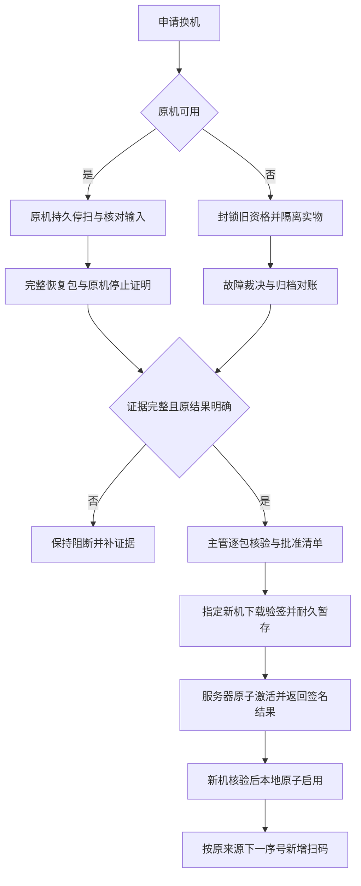

# PDA换机与交接设计提案

依据：[证据E01～E08](EVIDENCE_BASELINE.md)、V2.3 §6.5/6.7。以下状态属于拟议交接案件，不替换现有订单、提交或召回状态。

## 1. 不变量与角色

1. 一个稳定作业来源只有一个可新增的当前作业资格；存在canonical订单时其活动槽也唯一。心跳超时、48小时到期、退出/重新登录、短码登记、换设备及主管点批准均不能自动接管。
2. 原设备自己的密钥和身份不迁移到接收机。接收机先独立完成短码登记及登录，按指定人员/仓库取得新资格；可以同人换机，也可以换人换机，历史人员不变。
3. 原事实、已冻结正文、签名回执及来源审计只读；代传人的身份另存。接收机不得执行原机未决AUTO意图或未确认MANUAL候选。
4. 原机本地持久停扫、服务器旧资格封锁、新机本地激活是不同事实。服务器无法即时停止离线设备；故障分支须有实物隔离及设备停止使用证据。
5. 任何未知提交结果先查原ID及原正文。成功则走更正；尚未终结则先终结/对账；不存在记录不是自动允许改ID的证据。
6. 原有包占用持续保护，保留包切换所有者时无释放窗口。数量从逐包有效集合重算；不得把恢复包累计总量当作新增量再计一次。

角色为申请人、原作业人员、主管核验/审批人、指定接收人及恢复处理人；具体专项权限见[接口提案](INTERFACE_PROPOSAL.md)。**换机审批岗位已于 2026-09-26 确认为主管**（原待定项D01，权威记录：主树 `docs/BUSINESS_POLICY_R07.md`）；申请与批准是否由不同人员承担仍属上线配置与职责分离安排，按既有规则处理，不改变现有账号配置，审批功能本身仍待实现。

## 2. 四类入口与阻断

| 情况 | 可独立推进的动作 | 激活前必须满足 | 阻断及去向 |
| --- | --- | --- | --- |
| 原机可用、完整资料可读 | 停止新增接收，完成在飞落盘，核对未决输入，冻结并上传恢复包，原机stop-ack | 原机停止证明、完整原事实/审计/高水位、原提交明确终态、实物集合一致 | 未停止/未决输入/缺审计/包冲突，留本案件补证据 |
| 原机损坏/丢失，但独立归档足以恢复 | 登记故障，封锁旧在线/业务资格，实物隔离；收集已提交正文、归档及检查点 | 专项故障裁决证明旧机不再参与现场，完整原来源及高水位可证，全部实物和结果已对账 | 普通原机stop-ack不可伪造；替代证明和代传接口未就绪时阻断 |
| 证据缺失或无法证明最终高水位 | 保存已知证据及未知区间，盘点受影响货物，保持隔离，查归档/原机 | 取回并核验完整证据才可同单续扫 | 无法取回：标记顺序不完整，禁止同单续扫；进入损失/恢复案件，不猜序号 |
| 提交、停止、批准或激活结果未知 | 只查询原请求/原对象，必要时同ID同正文重试 | 查询到可验的权威状态且本地耐久确认 | 不创建第二申请/批次/授权；恢复代次变化转R09，404不当成未发生 |

缺失事实最终无法恢复时，允许设计上的“关闭为未完整恢复”记录损失，不允许称为成功交接。新订单作业只可在恢复/实物处置明确终结旧义务、隔离解除且库存合格后单独授权；新盘点/新扫码以真实新来源记录，不补造原机capture、人员、时间或顺序。此路径依赖R09裁决，未具备前保持阻断。

## 3. 状态模型

案件主状态：`REQUESTED → EVIDENCE_PENDING → REVIEW_READY → APPROVED → TARGET_PREPARED → ACTIVATED`；分支为 `RECONCILIATION_REQUIRED`、`REJECTED`、`WITHDRAWN`、`CLOSED_INCOMPLETE`。`RESULT_UNKNOWN`是客户端传输状态，不能作为后台业务终态。

每案件额外呈现四个维度，避免单一状态掩盖问题：

| 维度 | 候选值 | 证据 |
| --- | --- | --- |
| 停止 | REQUESTED / DEVICE_ACKED / FAULT_FENCED | 原机在线确认后由服务器签发、原机核验的停止回执，或独立故障裁决与实物隔离凭据；后者不能显示“原机已确认” |
| 完整性 | COMPLETE / MISSING_RECORDS / MISSING_AUDIT / UNKNOWN_HIGH_WATERMARK | 逐行摘要、来源授权链、分来源覆盖与完整订单高水位 |
| 原提交结果 | NONE_VERIFIED / NONTERMINAL / ABORTED / REJECTED / SUCCEEDED / UNKNOWN | 活动槽、控制头、回执及归档；NONE_VERIFIED要求证明未冻结过批次 |
| 实物 | UNCHECKED / MATCHED / CONFLICT / QUARANTINED | 逐包保留/减少清单、地点、核验人员和时间、证据号 |

`REVIEW_READY`要求四维门槛全部满足，且恢复服务NORMAL、仓库及来源兼容。`APPROVED`不代表新授权可用。已停止后撤回申请只关闭本申请，不自动恢复A；重新作业必须另发受控资格。

## 4. 原机可用的完整流程

1. Web从正式订单或临时作业详情申请，固定稳定来源/scope、canonicalOrderId及canonicalMappingVersion、原计划revision/workRound、原设备/人员/资格、指定接收设备/人员、原因及expectedCaseVersion。FORMAL保留assignment；TEMP原assignment可空，必须有真实临时授权。锁后复核当前渠道为PDA；已成功立即转更正入口。未正式化TEMP先按R06恢复完整证据建立scope，不造正式订单。
2. 原PDA联网读到停止请求后，先持久写停扫标记；暂停广播接收和普通扫码/撤销/冻结入口。在途保存事务与停扫按同一本地写锁串行，证明高水位包括停止前已经耐久接收的一切输入。
3. 核对未决队列：原机可完成合法已确认意图，或明确拒绝并记录实物核验原因；未确认MANUAL可明确放弃。沿用现有召回的受控拒绝方式也须保留原确认意图和失败确认。存储故障无法判断时转故障分支，不在B上继续处理A的候选。
4. 冻结恢复包和停止事件同一Room事务保存。包覆盖全订单历史captures/scans/events、累计处置、来源授权历史、逐来源审计证明、全部输入高水位；失败、撤销、放弃均占号。接收/验签成功只表示证据收到。
5. 原机stop-ack绑定已耐久恢复包。服务器同事务封锁本来源旧轮次/作业资格、保存停止证明及审计/outbox。FORMAL撤销旧assignment作业资格；TEMP封锁scope/fromRound，不能默认撤销同机其他来源共享的通用TEMP授权。原机核验回执并保存后显示“本机已停止，等待交接”。网络失败从同一包/同一stop-ack恢复。
6. 锁定原提交控制头判定：SUCCEEDED改走更正；REVIEW_REQUIRED/RECEIVING等先经明确受控终结保存墓碑，旧批准失效；ABORTED/REJECTED可接续；没有冻结过批次须有完整队列及无批次证明，不能为适配现有续作伪造一个ABORTED批次。换机属于来源级受控续作：先关闭旧轮次，批准固定拟议toRound，成功激活时才推进workRound一次；未曾冻结的轮次同样适用，旧轮次永不复活。
7. 主管逐包核对保留集合与既有已批准实物处置。普通换机不隐含新卸货释放：有新减包要求先转实物处置，并在清单固定处置阶段/凭据；不把PDA现有“替换正文接收时释放”改成“批准交接时释放”。包周期、占用、计划/快照或处置状态变化，旧方案失效。
8. 批准固定清单，包含双方、历史来源全集、保留集合、全量高水位、新轮次及资格绑定。签发的是准备票据，不可扫码。接收机按本人在线身份下载、逐块摘要核验、校验来源链/库存/计划及本机冲突，然后一个Room事务保存 `TARGET_PREPARED` 和原请求。
9. 接收人确认实物及资料后请求激活。服务端锁后重新验证审批、双方/接收人权限、停止依据、原提交终态、包集合、映射版本、周期和恢复代次；同事务创建来源种类对应的新资格、推进唯一活动轮次、直接转保留占用、保存激活回执、审计和outbox。FORMAL新assignment的48小时从成功激活签发时计算，重试返回原时间。TEMP接收者须有自身有效临时授权，并取得仅限此scope/轮次/计划的交接续作票据；有效截止取两者较早者，不自动刷新通用授权或创建假assignment。准备票据不能延长扫码授权。
10. 新机核验激活签名及全部绑定，在单一Room事务安装历史只读记录、处置、guard、资格、计数器和汇总，再启用扫码。服务端已激活但本地未耐久成功时，只恢复原激活结果，不再发另一个授权。若接收机也损坏，开启下一次受控交接，不能退回批准状态重新选人。

## 5. 故障和证据缺失

故障申请将“原机是否被收回/断电保管”“实际货物范围与位置”“最后可信记录/联网截点”“可能在飞或未上传区间”分别记录。旧授权服务端失效不意味着离线机停止；若设备未受控且现场无法排除其继续装车的影响，禁止接收端激活。无法证明条码级影响范围时按整个受影响仓库隔离，不仅隔离已知几包。

故障替代停止凭据记录 `stopKind=FAULT_FENCE`、裁决者、原授权撤销事实、实物控制及证据来源，不能冒用A签名或宣称A发送了STOPPED。所有原记录仍必须验证原时点资格。仅有照片、总包数或主管口头确认不能证明输入高水位及原审计连续性。

来源设备不能登录、账号停用/人员离职：指定授权代传人可提交原证据，记录transportActor/transportDevice及代传许可；不能启用原账号或借用其密码/私钥规避校验。此能力在基线E01未实现，接口必须独立授权且仅证据接收，不能自动入账。

若归档中有完整停止/冻结记录，但后续仍可能有未上传新增输入，最后已知max序号只是下界；直到证明停止截点之前全覆盖，不得取max+1。审计缺口只用原事件/可信归档补齐，裁决可以承认缺失并关闭案件，但不能发一张“无缺口”证明。

## 6. 交接清单及跨设备防重

| 层次 | 必须固定的信息 |
| --- | --- |
| 案件头 | caseId、warehouseId、R06定义的source与scopeId、canonicalOrderId可空/canonicalMappingVersion、from/to设备和人员、revision/fromRound/toRound、from/to资格种类和引用、恢复代次、版本、原因 |
| 签名manifest | manifestId/schema、案件/审批摘要、停止证明摘要、恢复文件清单、原提交终态证明、完整输入高水位、计划/库存/政策摘要、逐行及保留清单摘要、来源链、有效时间 |
| 每条原输入/保存 | 原UUID、originDeviceId、originOperatorId、originAssignmentId（TEMP原值可空）、authorizationId及原凭据/用途、epoch、orderRevision、snapshot、sourceRecoveryEpoch、deviceCaptureSeq/orderScanSeq/localSeq、原时间/启动计数、周期、原正文摘要 |
| 分来源审计 | originDeviceId、afterSeq/throughSeq、检查点签名/摘要、实际事件页摘要、缺口集合；接收者不是来源 |
| 实物与激活 | 逐包原capture/dispatch引用、RETAIN/既有处置与阶段、位置/核验凭据；指定接收人确认、下载清单摘要、激活请求/签名回执 |

清单必须逐条列出允许继承的capture/scan/event及摘要，不能只凭设备ID和序号范围授权任意历史行。A→B→C链保留每一跳；C上A、B历史不可改写，C新增备注/处置事件使用C的来源并引用原行。基线的scan以captureId标识、没有独立scan UUID；清单继承这一身份，不为旧保存行补造“原scanId”。本文originOperatorId是原人员的语义名称，旧正文的operatorId/assignmentId等原字段名及原字节仍保留，不能为统一命名改摘要。

- `(originDeviceId, deviceCaptureSeq)`识别输入；`(originDeviceId, localSeq)`识别审计/保存事件；capture/event UUID独立唯一，基线scan沿用其captureId唯一引用。同键同摘要只复用，同键异文阻断。
- `(scopeId, orderScanSeq)`是新来源模型的稳定唯一顺序；FORMAL保留现有订单约束。canonical非空后通过唯一活动槽投影原来源顺序，不把null当唯一键或重编号。B从完整核验高水位+1开始；TEMP的creatorDeviceId/clientOrderId、scope及别名沿用R06，不用B身份建第二来源。
- B的设备计数器从B已持久下一号继续。导入A的设备序号不更新B计数器；B已有1时其新输入用B的下一号，绝不沿用A的高水位作为B设备号。
- guard仍按条码保护全机，来源/周期作为证据。导入与B其他在途、待审、结果未知guard冲突时停在暂存阶段，绝不覆盖。已确认旧周期guard只能经核验的CYCLE_REOPENED及完整状态事件受控替代。
- 跨设备无可证明的全局物理时间顺序。订单内采用连续交接的orderScanSeq；设备各自localSeq递增。顶层freezeDevice=B只证明本批次冻结人，不能成为所有事件的来源。

## 7. 锁、重试与撤回

后续实现遵守[接口提案](INTERFACE_PROPOSAL.md)的统一锁序，和领取、续期、召回、提交、PC占用、库存发布/更正串行。批准/激活时重新校验，不能相信申请时校验结果。

批准后、激活前允许有记录地撤回，但撤回和激活竞争只能一个生效；撤回成功须使准备票据不可激活，仍不释放包或恢复原机。激活成功以后不得普通撤回，继续处理须形成新案件。多台接收机下载同一清单时，只有清单绑定的设备/人员可激活；同一案件重复激活返回同一个新资格及回执。

恢复代次在任一步变化，保留全部原正文/请求及暂存，进入独立RECONCILING；当前会话重新登录不能让旧清单生效。R09签发的范围对账确认及当前代次重批清单就绪后才能重新走准备/激活，不能只改请求header或把UUID当递增数字。

## 8. 临时来源与升级衔接

TEMP正式化/关联改变canonicalMappingVersion时，既有待审、批准和接收端暂存全部需重新核验并重批；产品映射mappingRevision是另一字段。关联双方scope、订单、提交槽和包的锁集合须先收集；锁内发现目标改变则回滚重取，不逆序追加锁。临时单同人同机的续作/卸货仍由R06承担。[跨任务联审](CROSS_TASK_ALIGNMENT.md)给出身份、资格期限、责任和锁序对照。

接收端需升级才能识别清单时，可设计耐久暂停点：保留原请求、清单摘要、暂存游标、停止和guard；安装与业务写入互斥，迁移受测后升级，再复核全部绑定。激活未知或未落盘不能伪装为只读待审以绕过升级检查；升级不自动激活或解除RECONCILING。
