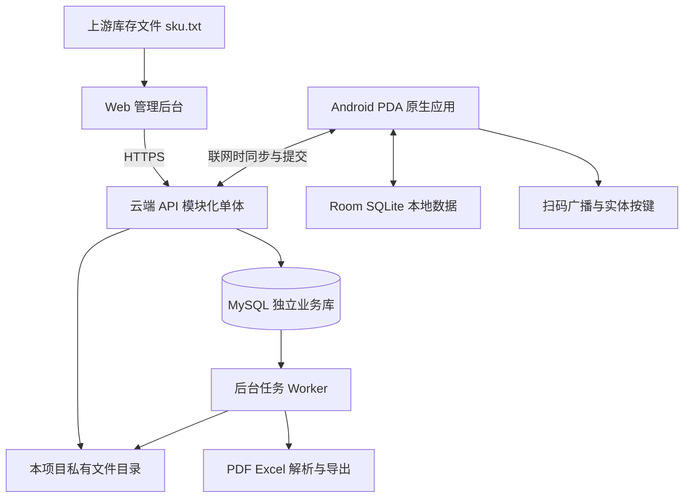
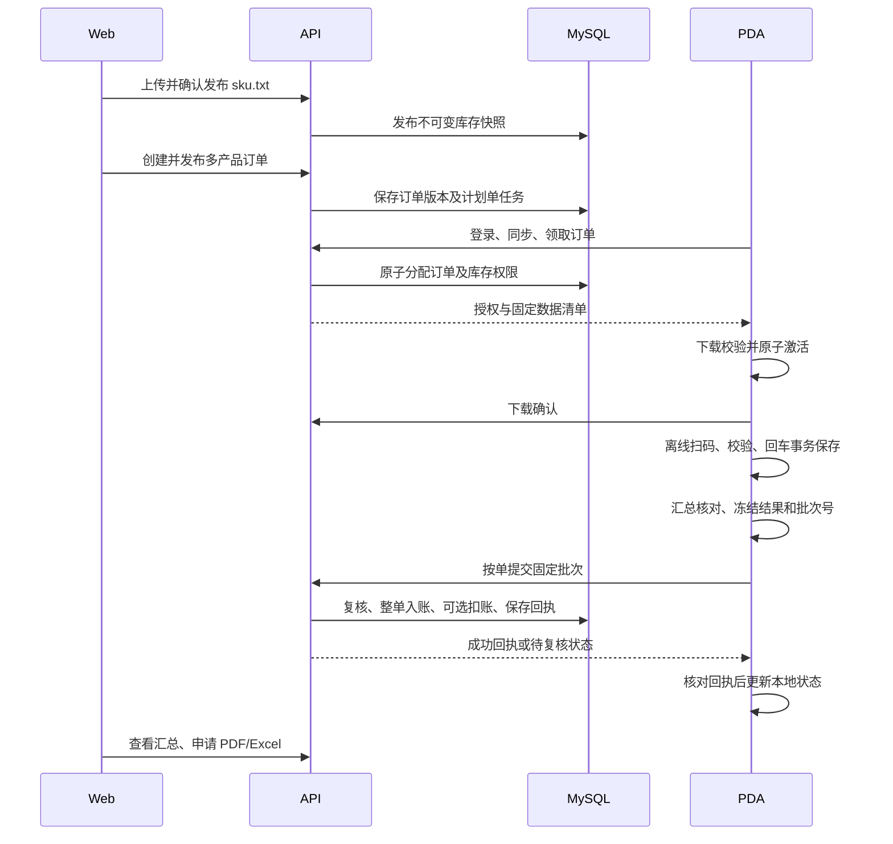

# 腈纶包仓储离线 PDA 扫码出库系统

## 系统设计方案与开发计划

> 历史 V2.2 保留稿。当前以 [V2.3](系统设计方案与开发计划-V2.3.md) 为准；2026-09-16 用户 Q16 已选择 B：扫码校验通过自动保存，手输 F1 后人工确认。本文旧逐包回车描述仅作历史追溯。

**版本：V2.2 方案评审稿｜日期：2026-09-15｜目标：完整功能交付**

**V2.2服务器适配：**根据《服务器信息与软件资产清单-2026-09-15.md》，推荐复用宿主机MySQL 8.0.45，替代此前的PostgreSQL选型；保留Vue 3 + TypeScript + Vite + Element Plus、Java 21 + Spring Boot和原生Android。采用现有Nginx、独立systemd服务、独立业务库及账号，详见第3.5～3.6、10.7、13.3节。本文更新的是设计，不代表已在服务器安装、部署或修改配置。

**V2.1补充要求：**用户确认保留每包一次实体回车保存；单机每秒1～4条完整扫码与本地提交作为必须验证的工作负载；有效出库明细严格按订单内扫码先后导出。第7.4、8.4、8.7、16.3节及相关数据字段落实本次修订，替换V2.0的“2条基线、3条目标、忙碌拒收”设计。

本方案以 `docs/README.md`、本次补充要求和会话中的最新确认作为主要依据，并参考目录中的 V1.3 技术文档与可行性审查报告。**最新要求优先：取消固定 116 包限制，取消 PDA 本地打印，新增 PDA 临时订单；其余要求纳入同一完整交付范围。**下文的开发里程碑表示依赖顺序，不表示删减功能或分期交付。

这是供业务、开发、测试和实施共同评审的设计方案，不代表软件已实现或已通过 M71 真机测试。已逐行分析新增的真实 `sku.txt`、`out.txt`；尚未确认的现场作业规则均列出建议默认值及确认条件。

**阅读建议：**先看第1～8节理解业务和现场操作，第15～18节查看开发安排、风险和待确认问题；第9～13节供开发人员实现数据与接口。已新增的 `DEVICE_SPEC.md` 也纳入设备依据，其双通道输入设置与本文建议的差异见第8.3节。

## 1. 方案结论与业务边界

### 1.1 推荐方案

采用 **Web 管理后台 + Java模块化单体 API + MySQL 8.0/InnoDB + Android 原生离线应用**。PDA 使用 Kotlin、Android View、Room，在本机完成临时建单、扫码、校验、保存、汇总及备注；服务器负责主数据发布、订单授权、库存协调、最终出库记账和报表。打印通过办公室电脑使用后台导出的 PDF 完成。

最关键的设计不是页面数量，而是以下规则：

1. **一单一车次，一单多个产品，各产品独立计划包数。**订单计划合计由明细计算，无固定 116 包上限；实际数量不得超过任一产品计划。
2. **离线开工前完成联网授权。**正式订单需要领取；临时订单可在预先授权的设备上离线创建，不要求后台提前建单，但仍须具备有效库存和人员授权。
3. **订单归属锁与条码占用分开。**一张订单只允许一台 PDA 活动作业；现场按已确认的不同货堆作业；不同订单不得最终记账同一包货。
4. **库存版本、订单版本和规则版本固定。**已开始的离线任务不会因后台刷新而被静默改写。
5. **校验通过不等于保存成功。**只有本地事务提交成功才能发出“已保存”提示音。
6. **按订单冻结并提交完整结果。**批次号和提交内容持久保存，重试复用原批次；服务器整单提交或整单不入账。
7. **确认出库事实与自动扣账分开。**即使关闭自动扣减，也必须防止同一包再次出库。
8. **已上传账据不直接删除或覆盖。**修改、作废、设备交接和已出库纠错分别走明确流程。

### 1.2 系统保证与现场前提

| 事项 | 系统可保证的内容 | 必须承认的边界 |
| --- | --- | --- |
| PDA 离线扫码 | 使用完整本地数据独立校验与保存 | 无法实时获知其他离线设备刚发生的事件 |
| 后台进度 | 展示最近上报进度、最终确认实绩和上报时间 | 完全离线时不能展示真实实时进度 |
| 同一订单互斥 | 联网领取时原子分配给一台设备 | 离线设备无法被远程瞬间停止 |
| 不同订单防重复 | 本机持续查重，云端最终全局唯一；用户已确认各车装不同货堆 | 误扫别堆时另一离线设备无法即时得知；严格条码预分配可增强，但不作为日常开工必需条件 |
| 本地可靠保存 | 事务、耐久配置、异常恢复和真机断电验证 | 单台设备彻底丢失或闪存损坏，未备份数据可能无法恢复 |
| 装车正确性 | 记录并核验扫码操作 | 扫过的实物是否真正装上对应车辆仍需现场管理 |
| 重量 | 按库存快照计算单包净重和合计 | 不能替代地磅，也不能据包数推断车辆合法载重 |

### 1.3 完整交付范围

包括库存导入及映射、库存查询及对账、用户与设备权限、多产品订单、PDA 临时订单及后台接收审核、修改作废及重新下发、订单锁与库存协调、PDA 全部离线能力、手动补录、音效、异常备注、审计、按单上传及恢复、可配置扣库存、PDF、Excel、缓存管理、部署备份和升级。PDA 不设计打印机接入、蓝牙打印或小票功能；所有保留模块均有验收要求。

## 2. 原描述中的矛盾、遗漏及优化建议

| 编号 | 原描述或缺口 | 风险或矛盾 | 本方案处理 |
| --- | --- | --- | --- |
| D01 | README 和旧文档保留 116 包限制 | 与本次明确要求冲突 | 删除业务固定上限；总计划仅为产品计划之和；容量测试包含超过 116 包的订单 |
| D02 | 旧文档排除扣库存、作废修改、锁、完整审计、备注 | 无法满足完整交付 | 全部设计和开发，旧“排除项”不再作为开发依据；PDA 打印按最新要求取消 |
| D03 | 期望办公室实时查看，但现场完全离线 | 无通信无法实时获取 | 后台区分“最近上报进度”和“已确认实绩”；显示更新时间及离线标记 |
| D04 | 多 PDA 只锁订单 | 不同订单仍可能误扫同一包 | 按用户确认的不同货堆作业，加本机防重与上传全局查重；完整描述冲突处理 |
| D05 | 锁未定义过期和换机 | 超时重派可能形成两台同时合法作业 | 心跳只监测；超时不释放；确认交接或人工隔离后再分配 |
| D06 | sku.txt 全量覆盖，同时支持扣库存 | 旧文件可把已出库包重新变成库存 | 主数据快照、上游库存声明、出库事实及账务分开保存 |
| D07 | 型号中有空格，解析规则不固定 | 简单空格分列会错字段 | 配置化文件格式、严格预检；错误行不导致不完整全量版本自动发布 |
| D08 | 前三位自动映射到型号品名 | 同前缀多型号时可能覆盖错映射 | 映射冲突隔离、人工确认；禁止“最后一行覆盖”；若确实多型号则调整产品标识模型 |
| D09 | 只校验当前订单重复 | 清缓存、换单、关闭扣减后可能重复出库 | 本机持久防重记录、云端全局出库占用、订单授权库存集合共同防重 |
| D10 | 校验和回车保存分离，未绑定对象 | 输入变化、回车连按、异步回调可能错存 | 输入状态机、不可变候选记录、串行保存与事务内复核 |
| D11 | “输入框+广播”接收 | 同一次扫描产生双通道输入，结束符可能误保存 | 推荐仅广播；人工输入仍使用输入框；不将扫码头模拟回车当人工确认 |
| D12 | F1/F2 与 K1/K2 的关系未实测 | 厂家按键码可能不同 | 提供设备诊断页和可配置映射；以真机事件为准 |
| D13 | 扫满强锁止 | 可能连查询、撤销误扫、结单都锁死 | 仅禁止新增相关产品；汇总、备注和受控撤销仍可用 |
| D14 | 短装、零包、撤销误扫规则缺失 | 无法结单或误上传 | 零包不得正常出库；短装需原因和主管批准；提交前允许有审计的误扫撤销 |
| D15 | 每次上传新 batch_id，重复批次直接成功 | 回执丢失后不知是否成功，同批次可能被换内容 | 每个冻结结果一个批次；内容摘要绑定；提供结果查询 |
| D16 | 建单即生成装车单 | 创建时没有实际包数及重量 | 创建后生成计划单，出库成功后生成实际单，两者明显区分 |
| D17 | WAL 等于断电不丢数据 | WAL 本身不足以证明耐久性 | 明确同步策略、提交后反馈、真实硬件故障测试和保证边界 |
| D18 | 时间同步被理解为修改系统时钟 | 普通 Android 应用缺少系统校时权限 | 计算业务时间偏差，保留原时间、单调时钟、序号和时间质量 |
| D19 | 单包约 300kg | 若按统一重量估算会造成台账错误 | 单包独立重量、整数克计算，汇总后再展示 kg |
| D20 | 旧系统被描述为没有操作员、作业时间 | 实际 out.txt 已包含人员和分钟级时间 | 保留这些历史信息；补充订单、设备、车柜号、精确事件与身份凭据 |
| D21 | 旧规则不允许 PDA 建单 | 用户最新要求支持现场临时单 | 增加独立临时建单权限、离线 ID、上传审核和防重复正式化 |
| D22 | 当前输入输出文件默认可以互相补全 | 样本 out.txt 的全部条码都不在当前 sku.txt 中 | 历史导入保持独立来源，不自动回填当前库存，不触发再次扣减 |

旧审查报告中“保留 116 包”“按旧范围后置功能”的建议随本次要求失效；其中有关幂等、时间、断电、版本和并发的风险仍纳入本方案。

## 3. 总体架构、技术选型与联网边界

### 3.1 架构图



Web 和 PDA 均通过 API 访问数据，不能直连数据库。PDA 扫码关键路径只有本地查询和本地事务，不访问云端。后台任务与 API 共享业务代码和本项目数据库，但作为独立进程运行，避免大文件导入或 PDF 渲染拖慢提交接口。服务器文件目录不由Nginx公开直出，下载统一鉴权；备份复制到独立异地存储。

### 3.2 可选路线比较

| 路线 | 优点 | 代价 | 结论 |
| --- | --- | --- | --- |
| 原生 Android + 模块化单体后端 | 物理按键、广播、Room 和故障恢复可控；部署较简单 | Android 与 Web 分别开发 | 推荐 |
| Web/PWA 或 WebView 为主的 PDA | 页面技术可复用 | 硬件集成和离线后台限制仍需原生桥接，低端机调优更复杂 | 不作为本项目主路线 |
| 多个微服务 | 可独立扩展大系统 | 分布式事务、部署运维和故障面增加 | 当前规模没有必要 |

### 3.3 推荐技术栈

| 层次 | 推荐 | 原因及注意事项 |
| --- | --- | --- |
| Web | Vue 3 + TypeScript + Vite + Element Plus | 保留选型；构建为静态文件交给现有Nginx，不需要新增常驻前端进程 |
| Web 路由、状态及请求 | Vue Router 4、Pinia、统一 HTTP 客户端 | 服务端分页；复用管理布局、菜单、会话和错误处理；不在浏览器维护库存账务 |
| API | Java 21 LTS + Spring Boot 受维护兼容版本 | 服务器已有Java 21且MES已采用Spring Boot；新项目独立JAR和systemd服务，不并入MES代码或进程 |
| 后端依赖注入 | Spring 构造器注入 | 依赖明确，领域服务与外部适配器可独立验证 |
| 数据访问 | Spring JDBC / NamedParameterJdbcTemplate + MySQL Connector/J + Flyway | 明确控制MySQL事务、行锁和批量写入；冻结相互兼容的驱动及迁移工具版本 |
| 数据库 | 复用宿主机 MySQL 8.0.45，表使用 InnoDB | 新建独立库和专用账号；事务、唯一约束、精确数值及顺序查询满足业务，无需新增PostgreSQL |
| 文件 | 本项目私有目录 + 独立异地备份 | 适配现有65G可用空间及rclone运维能力；保存原始导入、报告和恢复包；不新增MinIO服务 |
| 后台任务 | MySQL 持久任务表 + 独立 Spring Worker | 短事务领取任务，租约恢复，初始重任务并发1；无需Redis、RabbitMQ或额外消息服务 |
| Android | Kotlin + XML View + ViewBinding + RecyclerView | 保留 README 路线，减少 UI 层复杂度；性能仍以真机测试为准 |
| Android 架构 | MVVM + ViewModel + StateFlow + Coroutines | 单向状态流，扫描事件串行处理；数据库和网络不阻塞 UI |
| 本地存储 | Room + SQLite WAL；持久数据明确同步策略 | 查询和事务一致性；禁止 destructive migration |
| Android 网络 | Retrofit + OkHttp；流式文件传输 | 成熟的超时、取消、TLS 和拦截器能力 |
| Android 后台 | WorkManager + 唯一任务 | 跨重启恢复上传；不承诺 WiFi 恢复后立刻执行 |
| Android 依赖注入 | Dagger Hilt，优先构造器注入 | 编译期生成，不依赖运行时扫描；统一 Worker、Repository 和设备适配器生命周期 |
| 短音效 | SoundPool，预载少量短 PCM/WAV 音效 | 延迟小；控制叠音，错误优先；不逐条播语音 |
| PDF | 服务端 HTML 模板 + Playwright Chromium 独立渲染 Worker | 中文排版、页眉页脚和打印样式直观；限制并发，固定字体及模板版本 |
| Excel | Apache POI SXSSF 流式写入 | 大台账避免一次性驻留内存；条码强制文本单元格 |
| 发布与运维 | Ubuntu 24.04、现有Nginx HTTPS、独立systemd服务、项目级备份 | 复用已安装工具及现有Java服务管理方式；新项目不要求改动Docker/Compose环境 |

具体库版本、许可证、中文字体分发许可、Android 9 最低兼容性在依赖冻结时核对并锁定。这里没有宣称任何未核验版本是“最新版本”。Android 使用受支持的构建工具与目标 SDK，同时保持 `minSdk 28`，实测新目标 SDK 下的广播与权限行为。

### 3.4 联网与离线操作矩阵

| 操作 | 离线可用 | 必须联网的部分 |
| --- | --- | --- |
| 首次登录、设备绑定 | 否 | 用户认证、设备登记、仓库授权 |
| 已授权用户本机解锁 | 是，需有效离线授权 | 续期、新增人员、账号权限更新 |
| 查看已缓存订单与库存 | 是 | 获取新的版本、全部云端历史 |
| 领取正式订单 | 否 | 原子锁定订单并获得授权；仅严格模式附加具体条码分配 |
| 扫码、手动输入、校验、保存 | 是 | 无 |
| 撤销本机误扫、异常备注、汇总 | 是，受状态权限限制 | 服务器已入账数据的更正审批 |
| 冻结结果、加入待上传队列 | 是 | 最终提交和回执核对 |
| 短装结单申请 | 是，可保存申请 | 主管批准及最终入账 |
| PDA 创建临时订单 | 是，需预先授权及有效库存 | 上传正式化、后台审核及跨设备最终核验 |
| 修改、作废、换机、重新下发 | 只能提出本地请求或展示旧状态 | 服务器协调、原设备确认或人工对账 |
| Web 查询与导出 | 否 | 云端数据和任务 |
| 清理已同步缓存 | 是，需已有完整回执 | 不得用“请求发过”代替成功证明 |

### 3.5 基于服务器资产清单的选型结论

依据是2026-09-15 14:33～14:38的只读盘点文件，本文未再次连接服务器。**推荐保留Vue 3 + Element Plus和Java 21 + Spring Boot，数据库改为复用宿主机MySQL 8.0.45。**

| 清单事实 | 对本项目的判断 |
| --- | --- |
| Ubuntu 24.04.4，4 vCPU、约16GB内存 | 支持现有Java与Web技术路线，无操作系统兼容障碍 |
| 采样已用约5.1Gi、可用约10Gi | 有增加受限API和单并发Worker的资源空间，但不是业务高峰容量证明 |
| 根分区可用约65G，使用率32% | 当前不足1MB的库存导入规模很小；长期容量主要受扫码/审计积累、导出和备份保留影响 |
| 宿主机MySQL 8.0.45，监听本地3306 | 可新建独立业务库供本机API使用；不必为本项目引入第二种数据库 |
| Docker中另有报表MySQL 8.0.19，经本地3307访问 | 该实例属于积木报表，本项目不借用它的库、账号或容器 |
| 已有OpenJDK21，MES正式/测试也运行Java21 | 保留Java后端与现有维护方式一致；Spring Boot依赖随JAR发布，不需要全局“安装Spring框架” |
| Node20、pnpm、Nginx已安装 | Vue发布为静态文件即可；构建可在开发机/CI完成，不依赖生产机Node版本满足未来Vite构建要求 |
| 未发现PostgreSQL和Redis | 业务没有必须使用它们的能力需求，减少新增运维组件更合适 |
| 已有每日备份、rclone异地任务和sysstat | 可复用方法与工具，但现有脚本是否覆盖新库、新文件要单独接入和演练 |
| MySQL库级信息未取得，峰值资源与恢复能力未验证 | 连接余量、缓冲池、持久化参数、binlog及备份恢复需要部署前核验 |

**数据库路线比较：**

| 方案 | 优点 | 代价与边界 | 本项目结论 |
| --- | --- | --- | --- |
| 宿主机MySQL独立库 | 不新增数据库服务；保持现有备份和运维生态；能力足够 | 与生产数据库共享连接、内存及I/O；须小连接池、索引和任务限流 | 推荐 |
| 同机新增PostgreSQL | 数据目录和进程可单独管理，原设计语法可保留 | 新增常驻资源、升级、监控和备份体系；仍共享CPU/磁盘，不能保证零影响 | 技术上可行，但当前没有必要 |
| 独立数据库主机或托管数据库 | 能进一步隔离资源与故障 | 增加费用、网络和维护工作 | 若实测高峰/持久化要求与共享实例冲突，再按证据选用 |

MySQL足以完成本项目的整单事务、条码唯一、库存扣减、幂等、审计和按序号导出。PDA每秒1～4条的识别/回车保存发生在本地Room，选择MySQL不会把逐包网络延迟带入扫码关键路径。选型迁移不能省略数据库约束，具体适配见第10.7节。

**前端框架选择：**Vue 3本身就是前端框架，Element Plus是它的界面组件库；Vite是构建工具，TypeScript是开发语言。React通常用的`antd`不能直接当Vue组件库使用，Vue对应的是Ant Design Vue。两者都能做后台，本项目没有需要改用Ant Design Vue的业务或服务器原因，保留Element Plus即可。

Web基础布局采用Vue Router + Pinia + Element Plus，复用成熟的菜单、标签页、表格、表单和权限展示模式。可以选维护良好且许可证合适的Vue 3/Element Plus管理模板并裁剪；不引入一个会替换现有业务后端、数据库或认证的整套低代码平台。清单只列出现有前端目录名，没有核实其组件库，不能据`wms-frontend-pure`目录名认定它就是某个可直接复用的框架。

### 3.6 同机部署与资源控制建议

以下为待部署时采用的设计值和命名建议，均未在服务器创建；具体域名、端口和目录须在部署前再次检查。

| 项目 | 建议布局 | 隔离原则 |
| --- | --- | --- |
| Web入口 | 独立业务子域名，现有Nginx新增独立站点配置 | 不覆盖ERP/WMS/MES站点；校验全部配置后受控reload |
| 前端文件 | `/opt/acrylic-outbound/frontend/dist` | 上传预构建静态产物，版本目录切换；不替换现有站点文件 |
| API | `/opt/acrylic-outbound/app/`，`acrylic-outbound-api.service` | 独立非root账号和JAR；仅监听回环地址，候选端口8083需部署时复核 |
| Worker | `acrylic-outbound-worker.service`，不对外开业务端口 | 与API独立进程；PDF浏览器子进程放在同一受限cgroup中 |
| MySQL | 宿主机`127.0.0.1:3306`，新库建议名`acrylic_outbound` | 运行账号仅本项目DML权限；迁移账号仅本项目DDL权限；不连报表3307实例 |
| 配置 | `/etc/acrylic-outbound/` | 项目专用凭据与文件权限，禁止复用生产项目.env内容 |
| 文件及日志 | `/var/lib/acrylic-outbound/files`、项目专用journal/日志 | 私有文件鉴权访问，轮转与容量阈值独立设置 |
| 备份 | `/opt/backups/acrylic-outbound`及独立异地前缀 | 单独恢复新项目；不能把整个共享MySQL恢复回旧时间点 |

**初始资源预算：**不是保证运行占用，也不是当前服务器已生效配置。实施时以预发布负载验证调整。

| 服务 | 建议初始设置 | 原因 |
| --- | --- | --- |
| API JVM | Xms128MiB、Xmx512MiB；服务MemoryHigh约768MiB、MemoryMax约1GiB；CPUQuota约100%（一个核） | 给堆外/线程/类元数据留余量，限制失控时的资源占用 |
| Worker及Chromium | JVM Xmx384MiB，整组MemoryMax约1.5GiB、CPUQuota约50%；PDF/大导出并发1 | 浏览器渲染可能比API更耗资源，限并发和超时；上限按子进程总量计算 |
| JDBC连接池 | API maximumPoolSize=8、minimumIdle=1；Worker最大2、最小0 | 本项目常驻连接上限约10，不把每台PDA映射成固定数据库连接 |
| 数据库资源 | 复用现有实例，先不更改全局buffer pool和max_connections | 每个库没有独立InnoDB缓冲池，新增负载仍需观察；连接预算还须给迁移/备份留量 |
| 重任务 | 单并发、限制文件体积、可取消、超时、流式处理 | 防止PDF、导出、导入和备份同时争抢4核CPU与磁盘 |

API与Worker的进程上限合计约2.5GiB，低于清单时点约10GiB可用量，支持“有条件适合同机部署”的判断；MySQL增量占用和文件缓存并不包含在此上限中。systemd限额可减少干扰，不能消除共享磁盘、内核和数据库实例的所有相互影响。

**部署前需要核实的具体事项：**

1. 利用已安装sysstat观察代表性业务高峰以及02:15业务备份、约02:35 MES备份、03:30异地同步附近的资源；新备份错开实际高峰，不能只按首次0.06负载判断。
2. 用获授权的数据库账号读取连接使用量、buffer pool、事务/锁等待、慢查询、`innodb_flush_log_at_trx_commit`、`log_bin`、`sync_binlog`、binlog保留与数据库容量。该清单尚未提供这些数据。
3. 确认MySQL当前耐久性可满足“已确认出库不因数据库崩溃丢失”的目标；若需要改共享全局设置，应单独评估生产影响。不能为了新项目自行放松持久化或提高全局连接上限。
4. 预发布环境验证同单抢锁、重复批次、同包并发、导出和导入压力，再观察现有系统响应/错误率/数据库等待是否恶化。新库和新账号是逻辑隔离，不是性能隔离。
5. 前端与JAR在开发机/CI构建；服务器只接收产物。为本项目安排兼容版本依赖，不因开发需要全局升级现有Node、Java、MySQL或Docker。
6. 现有Compose V2插件未安装，默认systemd方案不依赖它。Chromium及字体需固定版本并核验运行依赖；如需安装缺失系统包，作为单独部署变更评估，不能声称现有软件清单已包含它们。

本轮只据文件完成选择和设计修订，不执行SSH、软件安装、数据库创建、Nginx变更或服务重启。后续部署以实际资源和数据库参数复核为准。

## 4. 统一业务模型与规则

### 4.1 身份、包、产品、订单

| 对象 | 标识和规则 |
| --- | --- |
| 实物包 Bale | `bale_id` 为内部 UUID；`barcode` 为系统内全局唯一文本；保留前导零，禁止转数字 |
| 发货代码 DeliveryCode | 规范化条码前三位；当前设计假设一个有效代码唯一对应一组型号与品名 |
| 产品 Product | 独立 `product_id`，型号及品名有历史映射版本；不能仅靠可变名称关联历史订单 |
| 仓库 Warehouse | 当前支持一个仓库，表和权限保留 `warehouse_id`；同一实物包同一时间只在一个仓库 |
| 订单 Order | 一次车辆装货任务；同一车牌不同时间可建立多单，车牌不得做唯一键 |
| 订单版本 Revision | 车号、柜号、计划产品、规则配置等形成不可变版本；发布新版本须处理旧授权 |
| 订单产品行 Line | 每个版本内发货代码唯一；计划包数为正整数；不需要现场切换产品即可混扫 |
| 作业授权 Assignment | 绑定订单版本、设备、库存快照、规则版本及授权代次；严格模式另绑定可扫条码集合 |
| 扫码记录 Scan | 每次实际保存一个稳定 UUID；包含原始输入、规范条码、操作者、重量快照和本地序号 |
| 提交 Submission | 一个订单最终冻结结果的不可变批次；网络重试不是新的业务提交 |

默认条码生命周期内只允许一次有效出库。确有退货再出库时，使用经审核的入库/冲销凭据增加 `dispatch_cycle`，原出库仍保留；不能靠删除历史或再次导入 sku.txt 解禁。

### 4.2 包数与重量

- `订单计划包数 = Σ 产品计划包数`，`订单实际包数 = Σ 有效扫码记录数`。
- 每个产品满足 `0 ≤ 实际包数 ≤ 计划包数`。订单合计校验作为第二道一致性保护，不再含固定 116。
- 订单合计不允许人工编辑。产品计划正整数；数据库、协议存在数值表示范围，属于技术校验，不能借此新增任意车辆包数限制。
- 如需车辆承重提示，另用真实车辆载重和单包净重规则；在数据未明确前不以“包数 × 300kg”进行硬限制。
- 单包重量建议精度到 `0.001kg`。云端 `BIGINT`、PDA `Long` 统一保存整数克，例如 `302.5kg = 302500g`。
- API 中克数使用十进制字符串，避免 JavaScript 大整数和浮点误差；显示 kg 时按模板格式化。超过约定小数精度的文件行拒绝并列入错误明细，禁止静默四舍五入入库。
- 所有合计用整数加法，单位在字段名中明确；原始重量文本保留以便追溯。汇总净重不包含包装皮重、车辆重量，除非业务另定义字段。

### 4.3 六层校验的落地定义

开扫前先检查：订单可作业、授权属于本设备、离线身份有效、本地快照完整、剩余空间满足写入、没有上传结果未知等阻塞状态。该检查不取代六层条码校验。

| 顺序 | 校验 | 具体规则与反馈 |
| --- | --- | --- |
| 1 | 格式 | 去除已约定首尾空白及扫描结束符，按规则转 ASCII 大写；不自动删除中间字符、不把 O 改 0；长度/字符集按 `barcode_rule_version` 校验 |
| 2 | 产品 | 前三位对应本订单某一产品行；并核对库存记录的产品标识和订单行一致 |
| 3 | 库存与授权 | 条码在固定库存快照中存在、重量有效、未冻结、属于授权仓库；启用严格预分配时额外检查授权条码集合 |
| 4 | 重复及占用 | 本订单无有效记录；本机其他订单无占用；本机出库防重记录未禁用该包；撤销过的记录不计有效数量 |
| 5 | 产品计划 | 该产品当前有效数量小于计划；并发回车时仍在事务内复核 |
| 6 | 订单合计 | 当前有效合计小于计划合计；检查行汇总与总汇总一致，不使用 116 常量 |

当前 sku.txt 的全部12,639个条码均符合 `[0-9A-Z]{11}`。该规则可作为当前解析配置；未来文件若改变长度或字符集，必须明确更新规则版本，不能仅以 README 的一个示例推断永久不变。

服务端提交时独立重做相同业务校验，并增加身份权限、版本、授权代次、全局占用和提交状态检查。PDA 自报重量、车牌、操作员名称不能直接作为入账依据。

### 4.4 数量完成、短装与误扫撤销

1. 扫满只改变“新增扫码”能力，不自动上传，不关闭汇总、备注、撤销和结单入口。
2. 产品扫满后自动拦截该产品，其余未满产品继续混扫；总数扫满后显示“计划已完成，请核对结单”。
3. 正常结单至少一包。零包可申请取消作业或释放未使用订单，不能形成零包出库台账。
4. 建议默认允许申请短装，但必须逐产品显示差额、填写原因，由仓库主管审批；审批通过才最终入账。若现场不允许短装，则配置为严格足量。
5. 短装审批绑定提交批次、内容摘要及版本；审批后改变任何条码或备注，应重新冻结并审批，不能复用旧批准。
6. 冻结前撤销误扫需选择记录并填写原因，确认该包未装车或已卸回。保存 `VOID` 状态和审计，不硬删除；本机占用及汇总在同一事务内回退。
7. 撤销扫码不释放云端已分配的库存范围；该包仍属于当前授权，防止其他离线设备同时获得使用权。
8. 已入账记录通过更正/冲销流程处理；上传结果未知时禁止撤销或编辑原提交。

## 5. 库存主数据、全量导入与出库账务

### 5.1 sku.txt 导入流程

```text
上传原文件 → 保存文件与 SHA-256 → 检测/选择解析配置 → 流式解析至暂存区
→ 格式与业务预检 → 生成差异及错误报告 → 管理员确认发布
→ 数据库原子切换有效版本 → 生成 PDA 可下载清单
```

**解析配置包含：**字符编码（UTF-8、UTF-8 BOM、GB18030 等需确认）、分隔方式、列定义、条码规则、重量单位、小数精度、是否有标题行及换行规则。自动识别只能给建议，存在歧义时让管理员预览确认。

本次真实 sku.txt 已确定采用第5.6节的固定57字节解析配置，默认不需要用户自行选择分隔符。若未来文件格式变化，才提供其他明确的解析配置。型号包含内部空格；如果新格式没有可靠字段边界，仅定位条码不能唯一分开型号与品名，不采用猜测式拆分。

| 检查 | 处理 |
| --- | --- |
| 空行、BOM、末尾换行 | 按配置规范化，日志记录忽略行数 |
| 条码缺失、格式错误、重量≤0 | 错误行，给出行号、原始行、字段和错误码 |
| 重复条码且全部数据相同 | 报告重复；管理员确认去重后发布，保留原行关系 |
| 重复条码但重量/型号不同 | 阻断发布，不能任取第一条或最后一条 |
| 同代码多型号/品名 | 生成映射冲突，阻断相关全量版本发布 |
| 非法编码、文件截断、异常骤减 | 阻断发布或要求额外核对；阈值可配置，例如较上版减少超过 20% |
| 部分行解析失败 | 解析继续用于收集全部错误；**完整库存版本不自动发布成功子集** |
| 重复上传相同文件 | 返回已存在的导入任务；有意重新解析时显式选择新解析配置并保留关联 |

发布动作需带预期当前版本，避免两名管理员同时发布相互覆盖。发布过程中失败，旧版本保持可用；文件和暂存数据不是有效库存。

### 5.2 映射维护

- 系统从文件生成“候选映射”，无歧义的新代码可供确认；存在既有映射差异时必须处理。
- 有效映射采用版本记录，包含代码、产品、型号、品名、生效时间、来源导入和维护人。
- 已被订单使用的映射只能新增版本，不能覆盖历史快照。
- 停用代码禁止新建订单，既有授权按原版本执行或进入受控召回。
- 若真实业务中同一前三位确实对应多个产品，应将订单行唯一键改为“发货代码 + 产品标识”，按完整条码库存记录匹配；此变更需同时调整 UI、接口与校验，不能仅靠下拉框选择掩盖冲突。

### 5.3 四类数据分开保存

| 层 | 含义 | 谁可以改变 |
| --- | --- | --- |
| 主数据快照 | 某次 sku.txt 声明的条码、型号、品名、重量 | 成功发布一个新版本 |
| 上游库存声明 | 最新全量文件中是否仍存在该包 | 发布和对账流程 |
| 系统作业/出库事实 | 已分配给谁、是否已确认出库、是否隔离 | 授权、提交、交接、冲销事务 |
| 本系统库存账务 | 是否按本系统配置执行过扣账、对账及冲销 | 有唯一凭据的账务流水 |

查询页面分别展示“上游声明在库”“系统已出库”“可分配”“已预留”“隔离/待对账”，不能把它们混为一个库存总数。

**可分配包：**最新有效库存声明为在库、未冻结、没有活动预留、没有有效出库占用且无对账阻塞。即使关闭自动扣减，已出库包仍不可分配。

### 5.4 全量导入与在途订单

1. 新全量文件只改变新的主数据版本和上游声明，不删除扫描历史、出库占用、账务流水或仍被任务引用的快照。
2. 旧文件再次包含已出库条码：标为“上游仍在库/系统已出库”差异，保持不可分配；不能恢复为可扫。
3. 新文件缺少未占用条码：视为上游声明不在库；历史仍保留。
4. 新文件缺少已预留条码，或更改其产品：进入主数据差异处置；不自动释放预留。默认分堆模式下服务器可能尚不知道某包已被离线扫描，故差异按条码保留，上传时统一检查并关联相关订单。重大差异使提交进入人工复核。
5. 普通重量/名称修正默认只影响新授权，既有作业按锁定快照计重；后台展示差异。必须更正的错误需显式撤销旧版本有效性并召回作业，不能上传时悄悄替换重量。
6. 严重数据错误/冻结包可以阻止最终入账，但无法实时阻止离线扫描；现场已装货需主管核验处理。

### 5.5 自动扣减开关

- 配置由有权限管理员维护并审计；订单发布时把 `auto_deduct_inventory` 固定进订单版本，不能在上传重试期间因全局配置变化而改变效果。
- 开启：最终出库事务写入出库事实、有效出库占用和每包扣账流水，并改变本系统库存账状态。所有步骤同一事务完成。
- 关闭：仍写出库事实和出库占用，但不执行自动扣账；台账标为“已出库，未由本系统扣账”，由上游或管理员对账处理。
- 后续开启不会自动补扣旧订单。如需补扣，创建显式对账任务，使用原出库凭据的唯一业务键，防止重复。
- sku.txt 只是文件输入，本系统不能声称已自动修改上游库存系统。需要上游自动回写时须另定义对接协议。
- 退货、错误出库的恢复必须有实物确认与反向流水；不允许直接把状态手工改回在库而不留账据。

### 5.6 真实文件分析与确定的导入规格

本节是对本次提供文件的逐行分析结果；描述的是该样本，不推断所有历史文件必然同格式。

| 项目 | sku.txt | out.txt |
| --- | --- | --- |
| 大小 | 745,701 字节，约 728.2KiB | 4,926 字节 |
| 记录数 | 12,639，均非空 | 81，均非空 |
| 编码 | 严格 UTF-8 解码失败；GBK、GB18030 均可正确解码 | 同左 |
| 换行 | CRLF | CRLF |
| 分隔 | 每行不含换行恰好 57 字节，无 Tab | 每行 5 列，以 4 个 Tab 分隔 |
| 条码 | 12,639 个不同的 11 位大写字母数字条码 | 81 个不同条码 |
| 产品 | 145 个前三位代码、145 个型号，本样本没有代码映射冲突 | 3 个产品代码：151、062、022 |
| 重量 | 15.5～389.5kg，全部为整数或 1 位小数，合计 3,801,362kg | 合计 24,538.5kg |
| 跨文件关联 | 当前库存快照 | 81 个出库条码均不在当前库存文件中 |

**sku.txt 固定字节列布局：**先按原始 GBK 兼容字节切列，再分别解码；不要解码后用相同字符位置切割，中文占用字节不同。

| 字节区间（从 1 开始，包含两端） | 长度 | 字段 | 处理 |
| --- | --- | --- | --- |
| 1～20 | 20 | 型号规格 | 去首尾填充空格，保留内部空格 |
| 21～34 | 14 | 品名 | GBK 解码后去首尾填充空格 |
| 35～47 | 13 | 条码列 | 去填充空格后为 11 位文本 |
| 48～57 | 10 | kg 重量 | Decimal 解析后转整数克 |

完整样例：型号 `H815B 1.7 RE 38 300`、品名“有光短纤”、条码 `003B0051601`、重量 `305kg`。前三位 `003` 的前导零必须保留；样本有 28 个以 0 开头的发货代码。

品名实际包含有光短纤、半消光短纤、全消光短纤、高消光短纤，以及有光丝束、半消光丝束、高消光丝束。系统应从主数据读取，不把所有包写死为“有光短纤”。

`670B0000057` 为 `15.5kg`，`003B0048932` 为 `389.5kg`。它们需要业务核对是否属于正常尾包/余包或录入异常；导入应提示重量异常供检查，不能未经确认自动改成 300kg。

**out.txt 五列：**型号、条码、kg 重量、操作员显示文本、`yyyy/M/d HH:mm` 时间。人员名称内部有空格，不能按空格分列或擅自合并姓名。当前文件没有品名单独列，也没有订单、车牌、柜号和设备。

| 发货代码 | 包数 | 重量 kg |
| --- | ---: | ---: |
| 151 | 28 | 8,447.0 |
| 062 | 39 | 11,850.5 |
| 022 | 14 | 4,241.0 |
| 合计 | 81 | 24,538.5 |

文件时间范围为 2025-06-19 15:24～15:54。不能仅凭处于半小时内就断定 81 包是一车。若迁移，使用“历史导入批次”，保留原文件行和来源时间，车次关系由业务补录；不伪造订单，不自动扣当前库存。

新系统原生 Excel 台账替代人工 out.txt 分列；后台可提供旧 out.txt 解析预览和受控历史归档入口。旧文本格式导出仅在确有下游兼容需要时启用，不作为新系统权威账本。

## 6. 订单状态、修改作废与多 PDA 并发

### 6.1 云端与本地状态分离

| 云端订单状态 | 含义 | 常见允许操作 |
| --- | --- | --- |
| `DRAFT` 草稿 | 编辑中，不可领取 | 编辑、删除未发布草稿或作废留痕 |
| `READY` 待领取 | 已发布，计划单生成任务已建立 | 查看、领取、修订、作废 |
| `ASSIGNED` 已分配 | 有活动授权，设备可能离线 | 查询、进度上报、提交、申请召回 |
| `RECALL_PENDING` 待召回 | 请求修改、取消或交接，等待停止确认 | 原设备回传恢复包、对账；禁止新设备领取 |
| `REVIEW_REQUIRED` 待复核 | 短装、重大库存差异、设备异常等 | 审批或退回处理；继续保留必要占用 |
| `COMPLETED` 已确认出库 | 最终事务已成功 | 查看、导出、更正申请 |
| `CANCELLED` 已作废 | 未形成有效出库，取消流程已完成 | 只读；需要重新作业则复制新单 |

“已下发”用授权的 `download_ack_at` 表示，不再把所有下载、作业和完成状态压缩为三个枚举。“作业中”和离线进度属于设备最后上报的状态，后台不能假设它一直准确。

| PDA 本地状态 | 含义 |
| --- | --- |
| `CACHED_READONLY` | 只读缓存，没有作业资格 |
| `DOWNLOADING` | 授权已领取，但所需数据尚未完整落地 |
| `READY_TO_SCAN` | 授权和固定数据均完整，可开扫 |
| `SCANNING` | 有本地有效记录，可继续或受控撤销 |
| `FROZEN` | 已确认结单，记录及提交正文冻结 |
| `UPLOADING` / `RESULT_UNKNOWN` | 正在传输或已发出请求但结果未知，禁止编辑 |
| `REVIEW_REQUIRED` / `ACTION_REQUIRED` | 等审批或需人工处理 |
| `SYNCED` | 已核对服务器成功回执，可以只读查询和按条件清理 |
| `RECALLED` / `CANCELLED` | 已确认失去作业资格，保留历史与恢复资料 |

### 6.2 联网领取与不可超时回收的作业锁

1. PDA 可以预览待领取订单；点击“领取并准备”后调用原子领取接口。
2. 服务器锁定订单行，核验版本、设备及仓库权限，建立作业授权。两个设备同时抢单只有一个成功。若启用严格库存预分配，另原子验证和建立具体条码预留；默认分堆作业模式不要求开工前选出所有条码。
3. 授权包含 `assignment_id`、`device_id`、`revision`、`epoch`、`inventory_snapshot_id`、`allocation_version`、离线授权有效期和数据摘要。
4. PDA 下载并校验所有必需内容，事务内激活后发送可重复的下载确认；只有本机完整激活才可扫描。
5. 接口超时后查询“本设备活动授权”恢复，不生成新的授权。下载失败仍显示为已分配待下载，可重试。
6. 心跳可更新最后在线时间。**TTL 到期、令牌失效、设备离线都不自动释放订单或库存锁。**允许清理的只是无设备授权的临时导出/任务租约。
7. 离线授权建议默认 24 小时，按真实班次调整。过期停止新增保存、保留查询和待上传数据；不删除记录，不把库存分给其他设备。

### 6.3 跨订单的库存互斥

**已确认的现场规则：两辆车不会同时从同一堆货取包，各自装不同堆。默认采用“现场分堆 + 同单设备锁 + 本机查重 + 上传全局防重”模式。**当前 sku.txt 不含堆位，本系统不据此推断条码位置，也不要求仓库先建立完整库位系统才能作业。

领取订单时可填写货堆/区域备注，供人员核对；人工备注不是可靠的条码归属证明。临时订单同样遵循每车固定货堆的现场规则。网络可用时同步已出库/隔离条码，离线期间依靠本机记录和现场分堆。

若误扫跨堆导致两个订单包含同一条码，云端最多接受一份出库事实，另一单完整保留为冲突待处理；主管核对包实际在哪辆车，不能只删除重复行当作问题已解决。

**可配置的严格模式：**当业务可以提供堆位对应条码清单时，每个活动订单获得互不重叠的可扫条码集合；本地库存存在但不在集合内的包仍拒绝扫描。以下是该增强模式的落地办法，不是默认开工前置条件。

可扫集合可以大于计划包数，例如计划 80 包、分配同一独占堆位 100 包，操作员任扫其中 80 包。未扫的 20 包在最终入账或确认释放后解占。不能用自动随机挑选 80 个难以定位的条码替代现场分配方案。

| 现场条件 | 分配办法 |
| --- | --- |
| 有可靠库区/堆位/批次 | 后台按物理范围选择候选包并落实为明确条码集合；当前文件缺少这些字段时需维护补充属性 |
| 已知各车条码清单 | 导入或选择清单，服务器逐包互斥预留 |
| 没有位置数据，但可将一堆货暂时独占 | 给一个订单独占该候选范围，其他订单使用不同范围 |
| 多车必须任意混用同一堆货 | 需要作业区联网逐包预留，或调整现场流程；不能承诺完全离线即时防重 |

按产品数量“预留 80 包”不能代替具体条码互斥，因为两个设备仍可能各自选中同一包。高并发情况下通过全局每包唯一占用约束兜底。

### 6.4 修改与重新下发

| 订单情况 | 处理规则 |
| --- | --- |
| 草稿/未领取 | 用乐观版本锁修改，生成新发布版本，计划 PDF 重新生成 |
| 已领取、尚未保存 | 申请召回；原 PDA 联网后原子冻结作业、确认无有效扫码，再撤销旧授权并发布新版本 |
| 已领取、已有扫码 | PDA 停止新增，上传不可变恢复包和审计；保留实物占用；主管核验后决定保留兼容记录或卸货重做 |
| 同单保留原扫码后修订 | 产品、重量快照和条码仍兼容、计划不低于已扫数量；系统记录迁移关系；重新授权后复核全部记录 |
| 新版本与原记录不兼容 | 禁止自动合并；逐条撤销/卸货确认，或走已出库更正流程 |
| 已上传成功 | 不改原账据；非实物字段可形成可追溯更正版本，数量/条码/重量用更正凭据或冲销重开 |

召回确认要包含授权代次、最后本地审计序号、订单扫码序号高水位、输入队列处置结果、记录数及恢复包摘要。服务器校验已收到完整恢复包后，才接受确认；PDA 重启后不得恢复旧授权作业。修改与上传竞争时，按同一订单行锁串行决定：提交先成功则改走更正，召回先进入则提交转待复核，不能同时成功。

### 6.5 作废、换机与故障

- 未领取且未出库：直接作废，保存原因、操作者和时间；释放对应未使用预留。
- 已领取：进入待召回，不在后台一键“立即作废并重派”。原设备确认停止且实物核对后才完成作废。
- 原设备可用换机：冻结 → 回传恢复包 → 服务器确认 → 撤销旧授权并增加代次 → 新机下载恢复包及新授权 → 核对后继续。每条历史扫码人保持不变。
- 原设备失联/丢失：主管发起强制接管，旧授权失效、相关货物保持隔离；完成实物盘点和恢复对账后再授权。旧机回网的数据进入冲突恢复，不覆盖新单。
- 旧授权上传不会使记录丢失：提供“恢复包上传”接收证据并返回待复核状态，但不直接写有效出库账。
- 已出库订单不能当成普通作废释放库存。若货物已离开仓库，只能经过业务更正；退货重新可用需实际收货确认。

### 6.6 PDA 临时订单：没有后台订单也可以作业

临时订单是本次新增的完整业务路径，不是把正式订单绕过权限直接补写数据库。**支持联网和离线创建；没有缓存库存、首次未授权的设备仍不能凭空校验。**

1. 管理员授予指定用户和设备 `temporary_order:create` 权限。上次联网时下载可用产品映射、库存快照、离线授权和适用政策。
2. PDA 点击“临时建单”，填写车号（必填）、柜号（可空）、临时建单原因；选择一个或多个产品并输入各产品计划包数。不得用“不限量”绕过数量校验。
3. 在本地事务中生成 `client_order_id`（UUID）及可读临时号，如 `TMP-M71A-20260915-0042`。可读号只用于现场识别，UUID 才是幂等身份；不能依赖设备时钟生成唯一主键。
4. 固定本地可用的库存、映射、规则和扣账政策版本，进入与正式单相同的扫码状态机。临时标记始终可见，混合产品、F1 校验、回车保存和异常规则一致。
5. 结单时生成一次不可变批次，联网后整体上传。服务端以 `device_id + client_order_id` 唯一创建一张来源为 `PDA_TEMP` 的正式记录并分配正式订单号；重复上传不会多建订单。
6. 建议默认进入“临时单待审核”。上传成功接收不代表出库已确认，不立即扣账。主管核对车号、产品、实物、计划和冲突，批准后调用相同的最终入账事务。
7. 审核拒绝不等于货物没装车：保留扫描证据和必要库存占用，要求纠错、卸货或更正处理，不能直接删除临时单释放货物。
8. 临时单与后台后来补建的同车单可能重复。后台提示“同车、相近时间、相同产品”的候选重复，但不得自动按车牌合并。可选择关联尚未领取且无扫码的正式单：在单一事务内验证产品、计划、版本、占用和唯一提交，将临时记录标记为已关联；正式单已有作业时必须人工处理。
9. PDA 保留临时号与正式号对应关系；正式化不改变条码、原操作人、原扫描时间或提交批次。

**默认模式：**临时订单在本机已授权仓库库存内作业，遵循每车独立货堆，不要求联网领取具体条码。未上传、本机已上传和待审记录持续防重；上传后做全局复核。

**与严格库存互斥的关系：**若启用严格模式，上次联网先给设备分配一份可用于临时单的独占库存池；每次临时建单只在本地把池中的包分配给某个临时单。设备池未与服务器对账前不能转给别的设备，即使授权到期也不自动释放。正式订单需从本设备池明确划拨或获得与池不重叠的独立分配，禁止形成双重授权。

无论是否启用严格模式，都不能描述成“没有通信却实时知道其他设备动作”。模式写入政策版本，不能在正在作业的订单上静默切换。默认分堆模式已能完成本次业务范围；严格模式的数据表和接口作为明确扩展点，不增加默认操作步骤。

## 7. Web 后台与权限设计

### 7.1 角色与权限矩阵

权限按角色配置，并叠加仓库、设备、订单归属等对象范围。管理员可授予临时建单权限，但仓库操作员仍不因此拥有 Web 正式订单编辑权限。

| 功能 | 系统管理员 | 订单文员 | 仓库主管 | 仓库操作员 | 只读/审计人员 |
| --- | --- | --- | --- | --- | --- |
| 用户、设备、角色、系统策略 | 管理 | 无 | 查看授权范围 | 查看本机 | 审计查看 |
| 库存导入、映射发布 | 管理/授权 | 可授予 | 可授予 | 查询授权范围 | 查询 |
| Web 正式建单、未作业修订 | 可 | 可 | 可 | 否 | 否 |
| PDA 同步、领取、扫码、上传 | 可授予 | 通常无 | 可 | 本人/本机范围 | 否 |
| PDA 临时建单 | 可授予 | 通常无 | 可 | 单独授权后可 | 否 |
| 本机未冻结误扫撤销、备注 | 可 | 无 | 可 | 按授权，可审计 | 否 |
| 短装、临时单审批 | 可 | 不审批本人提交 | 可 | 否 | 否 |
| 召回、换机、强制接管 | 可 | 发起申请 | 可审批处理 | 确认本机停止 | 否 |
| 扣账开关、出库更正与冲销 | 可 | 发起申请 | 按专项权限 | 否 | 否 |
| PDF/Excel 导出 | 可 | 授权范围 | 授权范围 | 默认关闭，可单独授予 | 授权范围 |
| 审计查询 | 全部授权范围 | 本人相关 | 仓库范围 | 本机本人相关 | 专项范围 |

审批人原则上不能审批本人提交的异常放行；小团队需要例外时必须显式配置并留下理由。服务端执行权限检查，前端隐藏按钮只是体验优化。

### 7.2 页面与功能

| 页面 | 核心内容与操作 |
| --- | --- |
| 工作台 | 待领取、已分配、待复核、临时单待审、上传失败、库存导入异常；所有进度标注来源和更新时间 |
| 库存导入 | 上传、固定格式预览、统计、错误下载、版本差异、映射冲突、确认发布、历史原文件 |
| 库存查询 | 条码精确查询；代码/品名/型号筛选；上游声明、系统账状态、占用订单/设备、重量与快照 |
| 映射维护 | 代码、型号、品名、启停、历史版本、候选变更及冲突处理 |
| 订单创建/编辑 | 车号、柜号、多产品计划；总计划自动汇总；容量无 116 硬编码；展示可分配库存不足提示 |
| 订单列表 | 订单号、临时来源、车柜号、产品摘要、计划、最近上报数量、确认数量、重量、状态、设备、创建信息 |
| 订单详情 | 基本信息、计划版本、分产品汇总、条码明细、异常、审批、上传批次、库存流水、文档、操作时间线 |
| 订单汇总 | 按日期/车号/产品/人员/设备汇总；默认仅统计有效已确认出库；待审核单单独列示 |
| 临时单审核 | 临时号与正式号、建单原因、疑似重复正式单、计划/实绩差额、批准/退回/关联 |
| 召回及冲突中心 | 版本冲突、条码重复、失联设备、恢复包、实物核对和处理凭据 |
| 用户与设备 | 仓库权限、设备启停、离线授权、按键配置版本、APK 版本、最后同步、库存池 |
| 审计与导出中心 | 条件查询、任务状态、失败原因、重试、授权下载、模板版本和数据截点 |

列表采用服务端筛选和分页，默认按创建时间倒序并以 ID 稳定排序。订单详情的最近进度与最终实绩不能使用同一字段混装；尚未上传显示“云端未收到实绩”，不能显示为“实际 0 包已装车”。

### 7.3 PDF 与 Excel

| 文件 | 生成时机 | 内容 |
| --- | --- | --- |
| 计划装车单 PDF | 正式订单发布后自动排队 | “计划单”标记、订单及版本、车柜号、产品计划、计划合计、空签字栏；没有实绩时不虚构重量 |
| 实际装车单 PDF | 最终入账成功后自动排队，也可手动下载 | 产品计划/实际/差额/重量、总净重、操作员、作业时间、确认时间、异常说明、签字栏 |
| Excel 明细台账 | 单单或筛选结果异步生成 | 订单汇总表、产品汇总表、逐包明细表、异常表；含临时来源、设备、操作人、条码及原始时间质量 |
| 审批/历史预览文件 | 待审或历史记录需要查看时 | 显著标注“待审核”“历史导入”或“未确认”，不能与有效出库单混淆 |

- PDF 使用 A4，固定中文字体，重复表头、页码、跨页产品行、签字区；重量明确 kg。订单版本、模板版本、生成时间和数据截点记录在文件元信息及任务表。
- 超长型号、多个产品、长备注和多页明细必须有渲染验收，不缩小到无法阅读。
- 建单或出库成功不依赖 PDF 立即生成。导出失败只影响文件任务，可重试，不回滚已成功订单。
- Excel 条码、代码、车号、柜号为文本；保留 `003` 等前导零。重量为受控数值格式；文本字段不执行以 `= + - @` 开头的公式。
- Excel 超过单工作表行上限时拆分工作表/文件，流式导出；业务订单包数不限不代表单个 HTTP 正文或表格格式没有技术边界。
- 导出按权限过滤并记录审计；列表筛选条件、选中 ID、数据截点和修订版本进入任务，防止排队期间数据变化导致无法解释。

### 7.4 严格按扫码先后导出

**可以实现按扫码先后导出，但排序主键必须是持久化扫码序号，不能仅使用扫码时间。**每秒4条时，多条记录可能显示同一秒；设备改时、时钟回拨、联网校正、上传重试或数据库写入顺序都不应改变业务顺序。

| 字段 | 含义与规则 |
| --- | --- |
| `capture_id` | 每个完整输入事件的稳定UUID；同一次输入从接收、确认、保存到审计都引用它 |
| `order_scan_seq` | 订单内接收序号，从1开始递增；完整条码进入本地持久输入队列时，在事务内分配；失败和撤销也保留序号，不重复使用 |
| `device_capture_seq` | 本设备跨订单的接收序号，持久递增；用于核对设备输入先后，不与审计 `local_seq` 混用 |
| `received_at` | 应用收到完整条码的设备时间，保存毫秒；可显示 `HH:mm:ss.SSS`，不作为唯一排序依据 |
| `saved_at` | 出库明细本地事务成功时间，与识别/接收时间分开 |
| `local_seq` | 操作审计事件序号；保存、撤销、备注等都会占号，不能直接当订单扫码序号 |

**定义“扫码顺序”：**单机按应用接收到完整广播的顺序；手工条码在按F1提交完整输入时加入同一顺序。厂家未提供可靠扫描源序号时，应用不能重建广播发送前的硬件内部顺序。因此真机验收必须将已知物理扫描顺序与广播序列比对；若固件漏发/乱序，需要修正设备配置或厂家接口，不能用时间排序掩盖。

1. 单订单“扫码顺序明细”默认按 `order_scan_seq ASC` 导出。条码、产品代码、重量、扫码时间、保存时间、操作员、设备和异常作为普通列。
2. 同一车混扫A产品、B产品、A产品，明细必须保持A→B→A。分产品汇总放另一工作表；分产品分组不能改变默认逐包明细的顺序。
3. 错扫撤销后有效明细允许序号为1、3、4；第2条在审计/作废明细中仍保留。再次扫描被撤销的包产生新事件和新序号，不能改写旧记录或挪到原位置。
4. 界面可展示最新记录倒序，但明确其为查看排序。导出默认固定 `SCAN_SEQUENCE_ASC`，不随用户当前列表排序改变。
5. 上传请求、分块接收顺序、UUID大小、云端插入时间与批次重试都不改变序号。服务端验证订单内序号唯一；相同序号不同条码/事件返回冲突，不能自动重新编号。
6. 同单换机必须先完成受控停止和恢复包交接，将包括失败/撤销输入的序号高水位传给新机，新机从下一号开始。旧设备失联且高水位/原数据无法恢复时，该段只能标为顺序不完整并进入人工复核，不能声称恢复了精确原顺序。
7. 临时单正式化、同单修订保留原扫码序号；临时单关联空白正式单时沿用整段顺序。禁止把两张已独立扫码的订单无依据地拼成一个“严格现场顺序”。
8. 多订单导出先按明确的订单排序分组，再在每单内按扫码序号升序。同设备跨订单的事件流可以按 `device_capture_seq` 导出；不同离线PDA之间没有可证明的全局物理先后，只能分别展示，或把按时间合并的视图明确标为“时间参考”。
9. 历史 `out.txt` 导入保留 `source_line_no`，只能称为“原文件行顺序”。其分钟级时间不能证明更精确的硬件扫码顺序。

后台明细接口和导出服务使用同一顺序规则，游标携带订单ID及上一个 `order_scan_seq`，数据截点冻结。Excel跨页、跨表拆分也连续取数，不能按页内重新排序。默认明细序列与有效本地扫描序列逐项相同，是交付验收条件。

## 8. PDA 操作流程与 480×800 UI/UX

### 8.1 页面结构

```text
登录/本机解锁
  └─ 工作台：同步数据｜订单｜临时建单｜条码查询｜设置
       ├─ 订单：待准备、作业中、待上传、待处理、已同步
       ├─ 扫码页：输入、校验、确认保存、即时反馈
       ├─ 汇总页：分产品进度、异常、结单与上传
       ├─ 明细页：分页查询、提交前撤销、备注
       └─ 设置：声音、设备诊断、网络、空间、同步版本
```

工作台优先突出“正在作业”和“待上传 N 单”，避免将常用操作放在多层菜单。首次进入订单必须核对车牌；切单前突出目标车牌，未确认候选条码不得带到另一个订单。

### 8.2 扫码页线框与空间分配

480×800 是像素，实际 dp 要读取设备密度。以约 320×533dp 为设计起点，扣除系统栏后可用高度约 460～480dp，真机核实。

```text
┌──────────────────────────┐
│ 浙B12345       离线·已授权 │ 车号优先
│ FH…015  柜号…567   临时标记│
│ 已保存 35 / 180    10605.5kg│
├──────────────────────────┤
│ [719C0000056             ]│ 输入框
│ 当前：719 有光短纤 303kg  │
│ 719：20/80  ✓待确认        │ 固定反馈区
│ [F1 校验]       [F2 清空] │
├──────────────────────────┤
│ 最近：…0055 302.5kg 已保存│ 1～2条
│       …0054 303kg   已保存│
├──────────────────────────┤
│ [订单汇总]      [手动输入]│
│         回车：保存当前包  │
└──────────────────────────┘
```

- 顶部约 88～104dp，输入约 56dp，产品和状态约 56dp，辅助键约 48dp，底部约 56dp，其余留给最近记录和间距；用约束布局适配，不强塞 5～8 行。
- 包数使用 24～28sp，正文建议 16～18sp；关键状态不只用颜色，配文字和图标。型号较长时显示摘要并可展开查看。
- 触控目标至少 48dp，主要按钮 52～56dp，间隔 8dp；戴手套优先实体键。电容屏能否识别现场手套必须实测，不能靠加大按钮保证。
- 全部明细及产品卡片在汇总页滚动显示，扫码页不放横向宽表格。
- 默认不弹软键盘；点击“手动输入”才开启，键盘弹出时隐藏最近列表、压缩顶部，保持输入、反馈和保存动作可达。
- 扫描头不能识别但印字尚可读时手工输入；条码文字完全无法确认时暂停该包处理，不允许凭产品和重量杜撰条码。

### 8.3 广播和物理按键

已确认参数：

```text
Action = com.android.decodewedge.decode_action
条码字符串 Key = com.android.decode.intentwedge.barcode_string
```

只在前台扫码/查询页面注册接收器并根据页面路由结果；不在登录、审批确认框或后台悄悄保存。接收器仅提取受限长度的字符串并转交事件处理，不在 `onReceive` 中执行耗时操作。

| 输入 | 唯一职责 |
| --- | --- |
| 设备扫描键 | 触发扫描头；原则上由系统解码服务处理，应用不要拦截后又触发第二次 |
| 扫码广播 | 按完整字符串加入有序输入队列，自动校验，不自动保存；不覆盖当前待确认条码 |
| K1→F1 | 对手工输入的当前条码执行校验；有对应大按钮 |
| K2→F2 | 清空手工草稿；对于已进入输入队列的当前候选，显式放弃并记录原因/审计，不清空后续队列、不删除已保存记录 |
| 实体 Enter | 对屏幕当前明确的队首候选确认一次；确认绑定 capture_id，长按和重复键事件不会确认下一包；仍需每包一次实际按下/释放 |
| 屏幕保存按钮 | 手工输入页提供与 Enter 等价的可达操作 |
| 返回键 | 返回上级；存在未保存候选时提示保留/放弃，禁止自动保存 |

M71 的 K1/K2 是否真正发出 F1/F2、是否有 `NUMPAD_ENTER`、扫码广播是否为字符串、厂商能否限制接收包名，都要在诊断页记录实际事件。新增 DEVICE_SPEC.md 还列出备用 Key `com.android.decode.intentwedge.barcode_data`；应先验证其类型和实际值，主 Key 有值时不再处理备用值，不能直接假定两个 Key 都是相同字符串。

DEVICE_SPEC.md 当前写的是“输入框+广播”。本方案建议在真机确认支持后改为“仅广播”，关闭键盘注入和自动结束符；手工输入功能不需要厂商“输入框输出”模式。如果固件只能双通道，扫码显示区保持不可编辑且不接收键盘注入，只有显式进入手工输入模式才开放输入；同时验证前台键事件过滤和结束符配置。若仍无法可靠隔离，作为设备接入阻塞问题处理，不能只用短时布尔变量宣称去重完成。

### 8.4 输入状态机与高速扫码

```text
完整条码广播 → 有界内存入口 → Room持久输入队列 → 顺序校验 → 显示待确认
                                                             ↓ 实体回车
                                                   持久确认意图 → 顺序保存事务
                                                             ↓
                                                   已保存反馈与实时汇总
```

每个完整输入绑定 `(capture_id, order_scan_seq, device_capture_seq, input_revision, barcode, order_id, order_revision, snapshot_id, assignment_epoch)`。接收事件不可被另一条广播或输入框变化覆盖。条码字段、身份、订单和版本作为不可变上下文贯穿后续步骤。

**接收、排队与字符完整性：**

1. 广播接收整条字符串；应用不通过键盘逐字符拼接扫码值，不把输入框当接收缓存。记录原始值和规范化值，长度/字符集异常明确报错，禁止截断到11位来伪装完整条码。
2. 接收回调只复制事件、记录时间和当前作业上下文，再交给有序单消费者；不等待网络、UI刷新或数据库事务。接收入口不做会吞事件的防抖、采样、只保留最新值。StateFlow仅用于界面状态，不能作为扫描命令队列。
3. 新扫码B在A校验、等待回车或保存期间到达，正常进入队列，既不拒收B，也不覆盖A。程序串行持久化输入与序号，保存处理按队列顺序进行。
4. 建议入口容量64个完整事件、待处理达到16时预警；这是吸收短时抖动的保护参数，必须真机调优。不能用无限队列掩盖持续处理不足，也不能用DROP_OLDEST/DROP_LATEST静默丢事件。
5. 目标负载1～4条/秒下必须无队列溢出、无忙碌拒收、无未解释丢失。超出验证负载或存储故障时，停用扫码入口（若厂家支持停扫则同步停止扫码头），明确要求暂停和核对；这种情况不算无漏扫验收通过。
6. 仅仅进入内存队列不算可靠接收。Room输入事件事务完成后才显示“已接收待处理”；最终出库事务完成后才显示“已保存”。如果广播未送达应用，或在首次持久化前突然断电，应用无法无条件保证恢复，须以反馈和核对流程识别这一边界。
7. 双通道必须按第8.3节隔离。不能通过“短时间相同文本全部忽略”处理重复，因为那会隐藏实际重复扫描；重复事件应被识别并留下明确校验结果。

**回车与保存的精确绑定：**

1. 屏幕突出唯一当前候选及其完整条码，显示“待确认N、已确认待保存M”。每个实际Enter按下事件在UI事件顺序中绑定当时显示的 `capture_id + input_revision`，不允许异步执行时再读取可变输入框。
2. 若当前候选已显示而校验尚未完成，可以记录针对这一个候选的确认意图；只有同一版本校验通过才执行保存。校验失败则该意图失效，不能转用于下一条，也不自动保存修改后的条码。无候选时的Enter不积攒为未来确认额度。
3. 重复按下、长按repeat、同一按键的UP事件和键盘结束符不得重复确认；一次完整按下/释放周期最多确认一个候选。同一capture重复确认幂等。
4. 确认意图持久化后，可向操作员显示下一条候选，后台仍按输入顺序提交已确认项；不能在本条校验尚未确定或确认尚未登记时把一次回车误交给下一条。发生失败时保持明确失败对象，F2放弃或修正后再继续；后续已接收条码仍保留。
5. 保存事务再次检查候选、权限、重复、产品和总数量，原子写明细、条码占用、汇总、事件及输入队列完成状态；只有提交完成才播放保存成功音。异常时保留待处理项目并停止后续业务保存，避免错误被后续成功音覆盖。
6. 已确认且尚未完成的候选不可编辑或F2清除；确认前修改手工候选会撤销原通过状态，保留原输入事件并创建新的输入事件/序号，必须重新F1和回车。扫描错误的原始字符不被修正动作抹去。
7. 退出、切单、修改、冻结上传之前检查待接收、待确认、已确认待保存队列：只有全部处理完成或逐条明确放弃并留痕，才能完成切换/结单；不能把积压条码带入另一订单。
8. 重启后恢复持久输入与确认意图：未确认项仍需回车，已确认项在有效授权和同一上下文下复核后幂等完成，已保存项不重复插入；上下文变化则进入明确待处理状态。

用户已明确保留每包一次回车，不增加自动保存模式。每秒4包的完整人工操作还包含4次有效扫描和4次回车；软件吞吐与实际按键节奏分别验收，不能把注入广播的速度当成操作员已完成装车的速度。

### 8.5 声音和异常

| 事件 | 建议声音 | 屏幕反馈 |
| --- | --- | --- |
| 扫码头识别 | 厂家提示音，可配置 | 只代表识别，不代表出库保存 |
| 校验通过 | 默认轻提示或静默 | “校验通过，回车保存” |
| 保存成功 | 短且明确的确认音 | “已保存”，数量和重量更新 |
| 失败/超量/重复 | 区别明显的双音 | 原因、条码、解决办法；不阻塞下一次纠正 |
| 产品满额/整单完成 | 与普通成功可区分的完成音 | 提示该产品完成或核对结单 |

设置支持应用音效开关及分别开关，静音时保留图文和设备支持的短振动。扫码头自带声音是否能由应用控制以厂家能力为准，不能承诺同一个开关一定控制系统解码音。错误音优先、合并重复提醒，不让大量成功音遮挡失败音。

异常类型建议：标签模糊、包装破损、条码人工输入、数量差异、库存信息疑问、其他。每条异常保存类型、严重程度、备注、相关订单/扫码和操作者。一般备注不阻断；严重破损或身份不明设置“待处理”，主管确认前不得正式入账。对校验未通过的条码也允许记“异常尝试”，但不得计入出库数。

### 8.6 本地缓存、身份、时间和低端机优化

- 单条条码查询走索引。12,639 条库存可完整存本地 SQLite，无需把整个库存装进 Kotlin Map；正常同步优先完整快照，减少不必要的增量协议复杂度。
- 最近列表查询有限条数，完整明细分页；汇总在保存事务中增量维护，启动时可从有效扫描重算核对。
- 扫码期间不切换所用快照，不并行执行大批量导入或清理；长任务在同步页显式执行，避免抢占闪存写入。
- 峰值进程 PSS 目标≤250MB；这是验收目标，不是当前测试结论。无大图、无复杂动画、不开长驻网络轮询，缓存和请求并发有上限。
- Room WAL 配合明确的耐久同步策略，关键保存验证 `synchronous=FULL` 的实际连接行为和时延；WAL 不是断电保证。禁止正常使用时直接复制单个 DB 文件做备份，应使用一致性备份/受控导出。
- 可清理：已核对成功回执、审计和异常已被服务器确认、无未完成恢复任务的已同步订单；建议本地保留 30 天，可配置。
- 不可清理：未提交、结果未知、待审、冲突、未补传审计、未完成输入/确认队列、仍被引用库存版本、有效授权和防重占用。清理显示明细不清除仍有效的出库防重凭据，也不重置扫码序号计数器。
- 低空间建议剩余不足 500MB 提醒；不足 200MB 或预计暂存需求不足时阻止新同步/开工，保留已有数据并引导受控清理，阈值实测可调。
- 登录令牌放 Android Keystore 保护的存储中，不存入普通配置表；离线解锁使用已缓存授权用户的本地验证，不能离线新增任意用户。
- 允许预先授权的人员同机交接；每条记录保存真正扫描人和其授权标识。上传人另记，不能把上一班的记录改成下一班姓名。
- 记录设备墙上时间、最近服务器偏差、单调时钟值、启动会话 ID、本地序号。设备重启或改时后标记时间质量，不声称精确恢复离线绝对时间。
- 作业开始定义为第一条成功保存时刻，结束为确认结单时刻；原始事件时间保留，即使首条被撤销也不抹掉曾经开始作业的事实。

### 8.7 DEVICE_SPEC.md 适配结论与性能预算

**结论：技术选型与目标设备相容，当前数据量适合本地处理；但仅凭配置文件不能证明每秒4条全链路已经达标。**现有仓库没有业务实现和真机压测结果。每秒4条是本次明确的验收要求，不能降低成“尽力优化”，也不能提前写成已保证。

| 设备依据 | 设计适配 | 仍需真机证明 |
| --- | --- | --- |
| Android 9 | minSdk 28，原生广播、View、Room、WorkManager | 实际固件权限、后台限制和扫描键事件 |
| 2GB RAM，应用PSS≤250MB | 不全量复制库存到对象集合；数据库索引查询、有限列表、短音效、固定队列 | 同步、长时4条/秒、异常恢复后的PSS及GC停顿 |
| 16GB Flash | 约728KiB原始库存、12,639条本地快照；历史分策略清理 | 实际可用空间、SQLite及索引/WAL的真实占用、fsync延迟、闪存磨损影响 |
| 480×800竖屏 | 小屏固定操作区、少量可见记录、物理键为主 | 真实密度、软键盘、强光和手套操作 |
| E3250/E3200扫码头 | 完整广播接收，关闭/隔离键盘注入及结束符 | 真实条码制式、连续触发、扫描距离/角度/污损下的识别率，完整广播顺序和漏发情况 |
| K1/K2、Enter、扫描键 | 明确分工和逐包确认绑定，忽略长按重复 | 能否稳定完成4次扫描+4次回车/秒以及事件顺序 |

4条/秒意味着平均每250ms到达一条。11字符×4仅44字符/秒，字符数据量很小；真正风险是厂商输入路径、线程调度、UI焦点、闪存同步和按键绑定，而不是原始字符串占用。原始txt大小也不能直接等同于Room数据库或总内存大小。

**预算与调优要求：**

- 完整事件接入的主线程处理目标P99≤5ms；数据库工作在专用调度器，业务写入单消费者有序进行，不创建每条扫码一个线程。
- 包含输入持久化、确认意图持久化、最终保存的每包累计数据库服务耗时建议均值≤125ms，留出接近一半余量；分别记录P95/P99和最长停顿，不以单条INSERT耗时替代完整链路。
- 回车至最终耐久保存目标P95≤100ms、P99≤200ms；持续吞吐≥4包/秒且队列不持续增长。是否能达到由M71闪存和实际事务数决定；队列只能吸收偶发抖动，不能弥补平均吞吐不足。
- 实时汇总只做必要字段和最近记录更新，UI渲染可合并到约10次/秒；**仅UI渲染可以合并，扫码、确认、保存及审计事件不能合并丢弃**。声音短于相邻操作间隔，避免多音叠加形成“已保存次数”错觉。
- 关键作业期间不执行全量同步、清理、PDF或Excel生成；网络按订单上传，PDF/Excel在云端完成。每秒4条要求指本地保存，不依赖每包网络请求。
- 如果在FULL耐久和完整审计下未达到目标，应检查输入路径、SQL/事务、调度与UI，再实测调优；不能通过先报成功、批量延迟落盘、关闭耐久或删掉审计换取指标。必要时更换硬件须由业务基于实测结果决定。

“不漏字符、不漏提交”的验收覆盖在约定条件下，已知完整输入和有效逐包确认都得到对应的耐久记录，且上传/导出逐项一致。损坏到无法解码的条码、未到达应用的广播、首次落盘前的断电不能由应用凭空补回；这些边界须明确报告，不能用一句无条件保证替代测试。

## 9. 同步、完整数据流与上传协议

### 9.1 正式订单端到端流程



### 9.2 同步清单与原子启用

1. 同步清单返回服务器时间、用户及设备权限版本、正式订单摘要、本设备活动授权、撤销/变更事件、库存快照版本、字节数/行数/哈希、规则配置及临时建单政策。另同步条码可用状态及其独立 `stockStateCursor`：即使 sku.txt 没更新，已出库、隔离、经审核恢复的状态也必须传到 PDA。
2. 库存采用版本固定的压缩文件或 NDJSON 数据流下载；以本样本规模优先整包重传，断点续传仅在规模或网络实测需要时启用。
3. 临时文件、暂存行与“已启用版本”分开。下载完验证压缩内容、解压后摘要、行数、字段和唯一性，事务内切换本地 active 指针。
4. 新版本失败保留旧完整版本。正在作业的订单固定引用旧版本，新的同步不得改写其库存内容。
5. 订单元信息刷新不得覆盖本地有效扫描、上传批次、备注或状态。云端新版本以“待处理修订”并存。
6. 库存版本和订单事件都使用不透明 cursor；分页固定在同一版本/高水位。仅在完整应用一页后推进 cursor；游标过期返回明确错误并重新取得完整清单。
7. 不能只同步“新建订单”：必须能够恢复本设备全部活动授权、待确认上传、召回、已完成回执和临时单正式号对应关系。
8. 确认消息丢失可以重复发送。服务器返回一致状态，不根据“第一次看到下载确认”再次创建锁。

库存快照固定型号和重量；可用状态流保存较新的出库/隔离事实，两者职责不同。本机应用状态更新时不得解除本机未上传或结果未知的条码占用。游标过期可全量刷新当前可用状态，但仍保留本机在途记录。状态事件带业务版本和出库周期，避免迟到消息把已出库包变回可用。

### 9.3 冻结、提交与回执

**本地冻结事务：**检查有效数量、未处理候选、严重异常和短装政策 → 固定有效扫码及业务备注 → 生成 `submission_id` → 保存规范化正文、摘要和期望汇总 → 状态改为 `FROZEN`。之后所有自动与手动重试读取同一份正文。

小订单可一次提交完整 JSON，建议单次请求≤1MiB且≤1,000条明细。超出时使用上传会话分块暂存，所有块完整且总摘要一致后调用 finalize；**这是传输边界，不是订单总包数限制**。分块只上传证据，不分块扣库存；最终仍按整单事务入账。

| 服务端提交状态 | PDA 含义 | 能否编辑/清理 |
| --- | --- | --- |
| `RECEIVING` / `PROCESSING` | 已接收部分或正在处理 | 不可编辑，不可清理 |
| `REVIEW_REQUIRED` | 短装、临时单或冲突需要处理 | 原批次不可编辑，不可清理 |
| `SUCCEEDED` | 已形成最终入账回执 | PDA 核对后只读；满足审计确认后可清理 |
| `REJECTED` | 已确定未入账，需纠错 | 服务器显式重新开放后才可形成新批次，原批次永久保留 |
| `ABORTED` | 服务端已确认取消该未入账批次 | 允许受控解冻并另建新批次 |
| 无明确结果 | 超时、断线、查询暂不可用 | `RESULT_UNKNOWN`；查询或重传原批次，不自行解冻 |

一旦尝试过上传，即便查询暂时返回“未找到”，也不能立即编辑，因为旧请求可能仍在处理。要改动时须先调用原子 abort：服务器建立该 `submission_id` 的永久取消标记，与 finalize 用同一行锁竞争；后到的旧请求必须被拒绝。提交先成功则 abort 返回成功回执，不能取消已经入账的批次。

成功回执包含订单 ID/正式号、提交 ID、规范摘要、确认包数、总克数、各产品合计、确认时间、扣账模式及结果版本。PDA 必须核对自身期望汇总和摘要后才能显示“上传完成”。待审核仅显示“已接收，待后台审核”。

### 9.4 服务器最终事务

最终处理统一供正式单、临时单审核、分块 finalize 使用，不复制多套入账逻辑。

1. 鉴权，解析正文；按 `submission_id` 查找并绑定规范化内容摘要。相同 ID 不同内容返回冲突。
2. 锁提交行及订单行，核验订单版本、授权代次、设备、状态、审批和已成功结果；唯一成功约束兜底。
3. 根据固定库存和映射快照解析条码，复核产品、数量、重量、例外处置和所有条码占用；按稳定 `bale_id` 顺序锁定相关记录以减少死锁。
4. 写有效扫码明细和异常关联，建立出库事实；默认分堆模式为尚无占用的包原子建立 `DISPATCHED`，已有本订单待审/严格预留则验证归属后转换。释放确认未使用的订单专属预留，同时写条码可用状态事件。
5. 如启用自动扣账，以唯一出库凭据写库存流水并更新库存账状态；关闭时也保留已出库防重占用。
6. 由实际明细重算分产品和订单合计，写 `COMPLETED`、提交 `SUCCEEDED`、审计和后台任务 outbox。
7. 一次提交数据库事务。任一业务校验失败不产生部分有效出库；失败证据和待复核批次可在独立受控事务中保留，界面不得计入有效实绩。

后台任务可以重复执行，但导出、通知及派生统计按唯一事件键幂等。PDF 失败不能改变步骤 7 已成功的业务结果。

### 9.5 重试调度

- 用户确认按单上传后，即可授权该批次自动重试；后台网络恢复只重传已经冻结排队的批次，不擅自结单正在扫码的订单。
- WorkManager 使用 `upload:<submission_id>` 唯一任务，同进程手动上传与 Worker 共享互斥。默认 WiFi 自动上传，移动网络需策略允许；“无计费网络”不等于一定是 WiFi，应检查实际网络传输类型。
- 建议超时：连接 10 秒，小提交读取 30 秒，大文件分块 60 秒。超时只代表结果未知，先查回执；不能据此认为提交失败。
- 退避从 30 秒开始指数增长，上限 30 分钟，加随机抖动；尊重 `Retry-After`。多次失败转为明显待处理提示，可继续人工重试，不丢任务。
- 401 尝试一次刷新，失败等待重新登录；403/业务冲突不自动无限重试。重新登录不清本地数据，代传须有权限并保留原操作人。
- 线上可选每 30～60 秒发送最新进度及必要恢复检查点；无网络时静默积累。进度不入出库账，恢复检查点须含实际记录才可用于恢复，单独的包数不是备份。

## 10. 云端数据库核心表与约束

### 10.1 通用规范

- 业务UUID在MySQL中使用`BINARY(16)`，新ID优先UUIDv7；API保留标准UUID字符串，已有示例/外部UUIDv4可兼容读取，不作为默认生成策略。事件流水可使用`BIGINT AUTO_INCREMENT`主键。版本、事件游标、本地序号使用`BIGINT`，序号的提交顺序约束见第10.7节。
- 绝对时间采用`DATETIME(3)`并统一保存UTC，应用/JDBC连接显式使用UTC；API仍为RFC 3339 UTC，界面按Asia/Shanghai展示。MySQL没有TIMESTAMPTZ，DATETIME不会自动处理时区，原设备偏差和时间质量另存，不能依赖服务器系统时区隐式转换。
- 条码 `VARCHAR(64)`，当前规则限制为 11 位；发货代码 `VARCHAR(3)`；订单号/临时号 `VARCHAR(64)`；车号 `VARCHAR(32)`；柜号 `VARCHAR(32)`；备注默认≤500字符。
- `g` 表示整数克 `BIGINT CHECK(g > 0)`，合计允许为 0；计划/数量用整数并检查非负/正数及求和溢出。MySQL 8.0.45支持实际执行CHECK；业务不设置 116 上限。
- 除明确标为“可空”的字段，关键业务字段使用 `NOT NULL`；外键默认 RESTRICT，不级联删除已发布订单、出库和审计。
- `JSON` 只用于版本政策、原始快照、审计前后值及错误详情，不替代经常查询的条码、订单、数量和重量列。
- 所有业务表使用InnoDB；中文文本采用utf8mb4。条码、发货代码及规范化技术标识使用ASCII及二进制比较规则，避免默认忽略大小写/重音的排序规则扩大相等范围；应用继续严格标准化和保留前导零。
- 下列表中的 `id` 均为 PK，`UQ` 表示唯一约束，`IDX` 表示普通索引。表结构是开发数据字典基线，迁移文件应落实这些约束。

### 10.2 用户、设备与配置

| 表 | 关键字段（类型或含义） | 约束/索引 |
| --- | --- | --- |
| `warehouse` | id、code、name、status、active_inventory_snapshot_id可空 | UQ(code)；发布事务原子切换快照指针 |
| `app_user` | id、username、display_name、password_hash、status、auth_version、created_at | UQ(username)；停用不删历史身份 |
| `role` / `permission` | id、code、name | 各 UQ(code) |
| `user_role` / `role_permission` | user_id/role_id、role_id/permission_id | 对应复合 PK；FK |
| `user_warehouse` | user_id、warehouse_id | 复合 PK；数据权限边界 |
| `device` | id、device_code、warehouse_id、public_key/credential_ref、status、app_version、config_version、last_seen_at | UQ(device_code)；IDX(warehouse_id,status)；设备密钥不明文保存 |
| `auth_session` | id、user_id、device_id可空、refresh_token_hash、expires_at、revoked_at可空 | UQ(refresh_token_hash)；IDX(user_id,expires_at) |
| `offline_authorization` | id、user_id、device_id、scope、policy_version、issued_at、expires_at、revoked_at可空 | IDX(device_id,expires_at)；签名凭据绑定用户和设备 |
| `policy_version` | id、warehouse_id、version、settings JSON、published_by、published_at | UQ(warehouse_id,version)；包含临时单、短装、扣账、并发模式等 |
| `api_idempotency_request` | id、principal_id、route_scope、idempotency_key、request_sha256、status、response_status、response_json、created_at、expires_at | UQ(principal_id,route_scope,idempotency_key)；普通写请求可保留7天；出库批次和终态标记按账据期限长期保留 |

### 10.3 主数据、导入与占用

| 表 | 关键字段 | 约束/索引 |
| --- | --- | --- |
| `product` | id、model、name、status | 稳定 ID；型号名称不作为外键 |
| `delivery_mapping` | id、warehouse_id、delivery_code、version、product_id、is_active、active_marker生成列、source_import_id | UQ(warehouse_id,delivery_code,version)；UQ(warehouse_id,delivery_code,active_marker)，活动为1、历史为NULL |
| `inventory_import` | id、warehouse_id、file_key、file_sha256、parser_version、status、total_rows、valid_rows、error_rows、created_by、created_at、published_snapshot_id可空 | IDX(warehouse_id,created_at,id)；同文件+解析版本+仓库去重 |
| `inventory_import_row` | import_id、line_no、raw_text、parsed_fields JSON、error_code可空、error_detail可空 | PK(import_id,line_no)；IDX(import_id,error_code)；发布后按保留策略归档 |
| `inventory_snapshot` | id、warehouse_id、version、import_id、status、row_count、manifest_sha256、published_at、invalid_reason可空 | UQ(warehouse_id,version)；每仓库一个当前指针，历史不可变 |
| `bale` | id、barcode、warehouse_id、dispatch_cycle、created_at | **UQ(barcode)**；IDX(warehouse_id,barcode)；前导零保留 |
| `inventory_snapshot_bale` | snapshot_id、bale_id、delivery_code、product_id、model_snapshot、name_snapshot、weight_g、raw_weight、location_code可空、lot_code可空 | PK(snapshot_id,bale_id)；IDX(snapshot_id,delivery_code,bale_id)；CHECK(weight_g>0) |
| `inventory_position` | bale_id、latest_snapshot_id、upstream_present bool、book_status、blocked_reason可空、row_version | PK(bale_id)；IDX(book_status,bale_id)；不覆盖出库事实 |
| `device_stock_grant` | id、device_id、warehouse_id、snapshot_id、epoch、status、policy_version、issued_at、closed_at可空 | IDX(device_id,status)；用于严格模式临时单离线库存池 |
| `stock_claim` | bale_id、claim_type、order_id可空、assignment_id可空、grant_id可空、dispatch_id可空、submission_id可空、discrepancy_id可空、epoch、created_at | **PK(bale_id)**，全局每包仅一个活动占用；CHECK 按类型有对应合法归属；IDX(order_id)、IDX(grant_id) |
| `stock_claim_event` | id、bale_id、event_type、old_owner/new_owner、reason、actor_id、created_at | IDX(bale_id,created_at,id)；占用流转追加记录 |
| `inventory_discrepancy` | id、bale_id、old/new_snapshot_id、type、status、resolution、created_at、resolved_by可空、resolved_at可空 | IDX(status,created_at,id)；条码消失/变更及冲突进入此表 |
| `stock_state_event` | seq BIGINT、warehouse_id、bale_id、barcode、state、state_version、dispatch_cycle、created_at | PK(warehouse_id,seq)；由该仓库STOCK流发布事务分配seq；库存可用状态独立于sku快照同步 |

`claim_type` 包括 `ORDER_RESERVED`、`DEVICE_POOL`、`REVIEW_RESERVED`、`DISPATCHED`、`QUARANTINED`，分别指向合法订单授权、设备池、待审批次、出库事实或隔离凭据。严格模式的设备池中的包离线只做本地分配，云端不能再借给另一订单；同步后在事务中转为订单占用或出库占用。活动占用与历史占用事件分表，避免历史数据妨碍唯一性检查。

### 10.4 订单、授权与提交

| 表 | 关键字段 | 约束/索引 |
| --- | --- | --- |
| `outbound_order` | id、warehouse_id、order_no、source WEB/PDA_TEMP/LEGACY、origin_device_id可空、client_order_id可空、temporary_no可空、current_revision、status、row_version、capture_seq_high_watermark、created_by、created_at、completed_at可空 | UQ(order_no)；UQ(origin_device_id,client_order_id) 适用于临时单；IDX(warehouse_id,status,created_at,id)；扫码序号跨修订不重置 |
| `outbound_order_revision` | order_id、revision、vehicle_no、container_no可空、planned_total、policy_version、auto_deduct bool、short_shipment_policy、temporary_reason可空、created_by、created_at | PK(order_id,revision)；planned_total 由明细计算；IDX(vehicle_no,created_at) |
| `outbound_order_line` | id、order_id、revision、delivery_code、product_id、model_snapshot、name_snapshot、planned_count、sort_no | UQ(order_id,revision,delivery_code)；UQ(order_id,revision,id)；FK(order_id,revision)；CHECK(planned_count>0) |
| `order_assignment` | id、order_id、revision、device_id、inventory_snapshot_id、policy_version、epoch、allocation_version、start_order_scan_seq、status、active_marker生成列、issued_at、download_ack_at可空、last_seen_at可空、closed_at可空 | UQ(order_id,active_marker)，活动/召回中为1、关闭/撤销为NULL；UQ(order_id,epoch)；IDX(device_id,status)；FK(order_id,revision)；交接起号基于完整恢复包高水位 |
| `assignment_bale` | assignment_id、bale_id、allocation_version、source_grant_id可空 | PK(assignment_id,bale_id)；与 stock_claim 一同校验归属 |
| `order_change_request` | id、order_id、old_revision、proposed_revision可空、type、reason、status、requested_by、recovery_package_id可空、approved_by可空 | IDX(order_id,status)；记录修改、召回、取消、接管 |
| `order_progress` | assignment_id、last_event_seq、device_saved_count、device_weight_g、device_state、device_reported_at、server_received_at | PK(assignment_id)；只应用更大序号，不覆盖最终实绩 |
| `submission` | id、order_id可空、client_order_id可空、origin_device_id、assignment_id可空、revision、payload_sha256、payload_schema_version、status、success_marker生成列、payload_file_key、expected_count、expected_weight_g、capture_high_watermark、capture_summary JSON、receipt JSON可空、attempt_count、created_at、completed_at可空 | PK(id)即批次幂等；UQ(order_id,success_marker)，成功为1、其他为NULL；成功必须关联非空order_id；IDX(origin_device_id,status) |
| `submission_chunk` | submission_id、chunk_no、file_key、sha256、record_count、byte_count | PK(submission_id,chunk_no)；同编号不同摘要拒绝 |
| `submission_approval` | id、submission_id、payload_sha256、type、approval_version、decision、reason、approver_id、decided_at | UQ(submission_id,type,approval_version)；审批绑定冻结正文 |
| `scan_record` | id、capture_id、submission_id、order_id、revision、line_id、bale_id、barcode_snapshot、weight_g、input_source、raw_input、operator_id、offline_auth_id、origin_device_id、order_scan_seq、device_capture_seq、local_seq、received_at、saved_at、device_time、corrected_time可空、time_quality | UQ(capture_id)；UQ(order_id,order_scan_seq)；UQ(order_id,bale_id)；UQ(origin_device_id,device_capture_seq)；UQ(origin_device_id,local_seq)；FK(order_id,revision,line_id) |
| `dispatch_record` | id、order_id、scan_id、bale_id、dispatch_cycle、status、posted_at、reversed_at可空 | UQ(scan_id)；UQ(bale_id,dispatch_cycle)；IDX(order_id)；有效占用由 stock_claim 约束 |
| `inventory_ledger` | id、bale_id、dispatch_id、entry_type、quantity_delta、weight_delta_g、deduction_key、actor_id、created_at、reverses_entry_id可空 | UQ(deduction_key)；UQ(reverses_entry_id) 限制单次完整冲销；IDX(bale_id,created_at,id) |
| `order_line_result` | order_id、revision、line_id、actual_count、actual_weight_g | PK(order_id,revision,line_id)；入账事务维护，可从记录重算 |

`scan_record` 保存已经确认的有效出库结果；接收但未入账的完整扫描在 `submission` 冻结文件中，后台可流式预览，不能提前算入库存账。误扫撤销、输入失败等通过操作事件保留。扫码 UUID 重传时必须与原正文一致，不能覆盖已有行。

授权状态采用 `ACTIVE`、`RECALL_PENDING`、`CLOSED`、`REVOKED`；前两种的active_marker为1，属于活动唯一约束范围，下载准备由 ack 字段表示。`inventory_ledger.quantity_delta/weight_delta_g` 为允许正负的流水差额，不套用单包重量必须大于0的检查。出库周期增加只允许经批准的实物恢复流程。

### 10.5 异常、审计、纠错与任务

| 表 | 关键字段 | 约束/索引 |
| --- | --- | --- |
| `exception_note` | id、order_id可空、submission_id可空、scan_id可空、barcode_text可空、type、severity、note、status、created_by、created_at、resolved_by可空 | IDX(order_id,status)；保留无有效 scan_id 的失败条码异常 |
| `operation_event` | id、origin_device_id可空、local_seq可空、capture_id可空、order_scan_seq可空、actor_id、event_type、entity_type、entity_id、before/after JSON、reason、device_time可空、server_time、request_id | UQ(origin_device_id,local_seq)；IDX(entity_type,entity_id,server_time,id)、IDX(actor_id,server_time)；接收/确认/保存/拒绝可关联同一capture |
| `audit_sync_checkpoint` | device_id、last_contiguous_seq、updated_at | PK(device_id)；仅确认连续落库事件序号，不跳过缺口 |
| `recovery_package` | id、device_id、assignment_id可空、client_order_id可空、file_key、sha256、last_seq、status、received_at | UQ(device_id,sha256)；隔离接收不等于入账 |
| `correction_document` | id、order_id、type、reason、status、requester_id、approver_id可空、evidence_ref可空、created_at | IDX(order_id,status)；原账据不可变 |
| `correction_line` | id、correction_id、dispatch_id、action、old_values/new_values JSON、physical_verified bool | UQ(correction_id,dispatch_id)；影响库存必须验证实物 |
| `temporary_order_link` | id、temporary_order_id、target_order_id、submission_id、actor_id、reason、created_at | UQ(temporary_order_id)；对应提交只允许一个最终目标 |
| `background_job` | id、job_type、dedupe_key、status、payload JSON、attempts、next_run_at、lease_owner可空、lease_token可空、lease_until可空、error可空 | UQ(dedupe_key)；IDX(status,next_run_at,id)；完成/续租必须匹配本次lease_token |
| `export_artifact` | id、job_id、order_id可空、revision可空、template_version、data_cutoff、filter_snapshot JSON、file_key、sha256、expires_at、created_by | IDX(created_by,created_at,id)；文件私有 |
| `legacy_import` / `legacy_outbound_row` | 批次文件哈希、解析版本；行号、原型号、条码、重量、操作员文本、分钟时间、可空车次关联 | 行 PK(import_id,line_no)；与当前库存账分离 |

### 10.6 索引与一致性说明

- 条码精确查找通过 `bale.barcode` 唯一索引，再按主键访问快照、占用、流水；不要对列套函数后模糊查找全部记录。
- 订单分页以 `(warehouse_id, status, created_at, id)` 为常用索引；实际查询可根据状态是否必选增加 `(warehouse_id, created_at, id)`，以 EXPLAIN 和真实负载确认。
- 子表外键列建立必要索引，避免删除检查及详情查询扫描全表。复杂汇总先分别按订单/产品聚合扫码与异常，避免一对多表直接连接使包数和重量倍增。
- `scan_record(order_id,order_scan_seq)` 的唯一索引同时服务顺序详情及导出；有效记录按该字段稳定游标分页，禁止依赖无ORDER BY的物理行顺序、UUID排序或秒级时间排序。序号、时间和身份都是冻结正文及摘要的一部分。
- MySQL 的普通 CHECK 不能引用其他行来保证“计划总数=明细和”；该规则在订单事务内重算并锁行，定期一致性核对。不要写无法真正执行的跨表 CHECK。
- SQL 行锁仅用于短时间事务；离线占用是持久业务记录，不能把数据库事务/连接保持几个小时作为订单锁。
- 用户、设备、库存、订单和提交的关联都由服务端校验；外键及唯一约束兜底，并不代替完整权限规则。

### 10.7 PostgreSQL草案迁移为MySQL的明确适配

这不是更换连接字符串。前文数据字典已采用MySQL兼容表述；下列规则须落到迁移文件和真实MySQL集成验收中。

| 事项 | MySQL实现约定 | 保护的业务规则 |
| --- | --- | --- |
| 条件唯一索引 | MySQL无PostgreSQL式`UNIQUE ... WHERE`；用可空生成标记列配合普通复合唯一索引 | 每代码一个有效映射、每订单一个活动授权、每订单一个成功批次 |
| active_marker / success_marker | 类型TINYINT，满足对应状态时取1，其他取NULL；标记由表达式生成，应用不能自行写标记 | MySQL唯一索引允许多条NULL，保留多条历史；同业务键+1至多一条 |
| 非空归属 | 映射warehouse/code、授权order_id不得为空；成功submission用CHECK要求order_id非空 | 防止利用NULL绕过最终成功唯一性 |
| UUID | BINARY(16)统一编解码；默认生成UUIDv7，不使用针对UUIDv1的字节交换规则；相同FK类型完全一致 | PDA临时ID、扫码ID及幂等ID稳定，不靠数据库ID顺序导出 |
| 时间与JSON | UTC DATETIME(3)、原始偏差字段、MySQL JSON；API字段格式不变 | 毫秒信息保留、不因服务器上海时区重复偏移、不用JSON承载常查关系 |
| 行锁和事务 | InnoDB短事务、按固定顺序锁订单/条码、唯一约束兜底；基线兼容现有REPEATABLE READ | 不修改共享全局隔离级别，不保持离线长事务 |
| 幂等重复写入 | 尝试插入，在唯一键冲突时查询并比对归属/摘要后返回原结果 | 不用REPLACE删除旧行，也不盲目ON DUPLICATE KEY UPDATE覆盖旧出库 |
| 后台任务领取 | 只在任务队列短事务中使用`FOR UPDATE SKIP LOCKED`，写租约后提交，事务外执行 | 允许多Worker恢复扩展；库存校验不得用跳过锁来漏查冲突包 |
| 死锁及锁等待 | 捕获死锁/超时，回滚整个业务事务，使用同提交ID有限次数带抖动重试 | 失败不会形成半单；不更换幂等键、不调低耐久设置 |
| DDL迁移 | Flyway使用单独迁移账号，仅本项目库；迁移明确评估元数据锁及隐式提交 | MySQL DDL不能按PostgreSQL事务回滚假设处理；不扫描/改动旧项目表 |
| 索引与SQL方言 | 使用MySQL支持的索引及执行计划；不使用GIN、INCLUDE、CREATE INDEX CONCURRENTLY、ON CONFLICT、NOT VALID等PG特有语法 | 最终性能和约束在实际目标引擎中成立 |

**事件游标不能只取AUTO_INCREMENT最大值：**不同业务事务可能先拿较小ID却较晚提交，直接按最大ID确认游标会跳过迟到提交。库存可用状态和订单同步使用业务事务内outbox，再由按仓库串行的发布事务分配同步序号；发布事务锁定该仓库游标行、写事件和高水位后一起提交。已提交事件的cursor因此不会越过未发布内容；业务事务原始ID不能直接充当同步确认位置。`stock_state_event.seq`由这一发布过程分配，相关游标/去重键放在`sync_stream`和outbox记录中。

补充表：`sync_stream(warehouse_id, stream_type, next_seq)`以仓库和流类型为复合PK；`sync_outbox(id, warehouse_id, entity_type, entity_id, entity_version, payload, published_seq可空)`在业务事务中写入，对实体版本建立唯一去重键。按仓库/流发布的seq是流内唯一，`stock_state_event`使用`PK(warehouse_id,seq)`，同步游标必须包含仓库和流类型。出库完成到状态可同步之间允许短暂队列延迟，不影响最终账务已提交这一事实。

维护同步序号的短事务与离线PDA的订单扫码序号是两套机制。Excel仍按`order_scan_seq`导出，不受MySQL主键、任务执行或同步发布时间影响。

**共享实例的耐久与恢复：**要实现进程/主机崩溃下的已提交事务耐久，需核验`innodb_flush_log_at_trx_commit=1`及底层存储行为；使用binlog做时间点恢复还须核验`log_bin`、`sync_binlog`及归档链。清单未提供这些值，本方案不假定它们已经满足，也不指示直接修改生产全局配置。

验收至少在与服务器兼容的MySQL版本上执行：两设备抢同单、同包跨单、同批次异内容、同单两批次成功竞争、生成列唯一性、NULL绕过、毫秒/UTC转换、事件延迟提交、死锁重试、重复扣账和顺序导出。SQLite本地部分索引仍由SQLite实现，不因云端改用MySQL而删除。

## 11. PDA 本地 Room / SQLite 数据设计

### 11.1 类型与表

UUID 在本地以 `TEXT` 保存；时间为毫秒 `INTEGER` 加时间质量字段；重量和序号为 64 位 `INTEGER`；布尔值为 0/1。SQLite 启用外键。提交和同步的大文件存于应用私有文件目录，数据库保存受校验的相对文件名和摘要。

| 表 | 核心字段 | 主键、唯一约束和索引 |
| --- | --- | --- |
| `local_user_auth` | auth_id、user_id、device_id、scope_json、policy_version、issued_at、expires_at、signed_claim | PK(auth_id)；密钥/令牌不在此明文保存 |
| `local_inventory_snapshot` | snapshot_id、version、status STAGING/READY、row_count、sha256、downloaded_at、invalid_reason可空 | PK(snapshot_id)；完整后才 READY |
| `local_inventory_bale` | snapshot_id、bale_id、barcode、delivery_code、product_id、model、name、weight_g、availability | PK(snapshot_id,barcode)；UQ(snapshot_id,bale_id)；IDX(snapshot_id,delivery_code,barcode) |
| `local_mapping` | mapping_id、delivery_code、product_id、model、name、version、status | PK(mapping_id)；UQ(delivery_code,version) |
| `local_cloud_bale_state` | barcode、bale_id、state、state_version、dispatch_cycle、server_event_seq | PK(barcode)；只有较新版本可以覆盖；不得解除本机在途guard |
| `local_stock_grant` | grant_id、snapshot_id、device_id、epoch、policy_version、status | PK(grant_id)；固定授权版本 |
| `local_allowed_bale` | owner_type、owner_id、bale_id、barcode、allocation_version | PK(owner_type,owner_id,bale_id)；IDX(barcode)；严格模式用本地占用防止同池重复 |
| `local_order` | client_order_id、server_order_id可空、temporary_no可空、server_order_no可空、source、vehicle_no、container_no可空、revision、snapshot_id、policy_version、assignment_id可空、epoch、state、next_order_scan_seq、planned_total、actual_count、weight_g、started_at可空、closed_at可空 | PK(client_order_id)；UQ(server_order_id) 对非空值；IDX(state,updated_at)；序号由事务递增，清缓存/改版不重置 |
| `local_order_line` | line_id、client_order_id、delivery_code、product_id、planned_count、actual_count、weight_g、model_snapshot、name_snapshot | PK(line_id)；UQ(client_order_id,delivery_code)；UQ(client_order_id,line_id) |
| `local_input_capture` | capture_id、client_order_id、order_scan_seq、device_capture_seq、raw_input、barcode、input_revision、input_source、operator_id、offline_auth_id、order_revision、snapshot_id、assignment_epoch、received_at、elapsed_realtime、boot_session_id、state、validation_result、confirm_requested_at可空、confirmed_input_revision可空 | PK(capture_id)；UQ(client_order_id,order_scan_seq)；UQ(device_capture_seq)；IDX(state,device_capture_seq)；持久接收与确认队列 |
| `local_scan` | scan_id、capture_id、client_order_id、line_id、barcode、bale_id、weight_g、status ACTIVE/VOID、input_source、raw_input、operator_id、offline_auth_id、order_scan_seq、device_capture_seq、local_seq、received_at、saved_at、device_time、elapsed_realtime、boot_session_id、time_offset_ms、time_quality | PK(scan_id)；UQ(capture_id)；UQ(client_order_id,order_scan_seq)；UQ(device_capture_seq)；UQ(local_seq)；IDX(client_order_id,status,order_scan_seq)；复合 FK(client_order_id,line_id) |
| `local_barcode_guard` | barcode、client_order_id、scan_id、state SCANNED/DISPATCHED/QUARANTINED、dispatch_cycle | PK(barcode)；有效占用唯一，已撤销释放本地扫描占用但不释放上级授权 |
| `local_candidate` | client_order_id、displayed_capture_id可空、manual_draft、draft_revision | PK(client_order_id)；仅界面候选引用及手输草稿，完整事件以local_input_capture为准 |
| `local_device_state` | device_id、next_device_capture_seq、next_audit_event_seq | PK(device_id)；序号与相应输入/事件在同一事务递增，避免杀进程后复用 |
| `local_exception` | exception_id、client_order_id、scan_id可空、barcode可空、type、severity、note、status、event_seq | PK(exception_id)；IDX(client_order_id,status) |
| `local_operation_event` | event_id、local_seq、actor_id、type、entity_id、payload_json、device_time、uploaded | PK(event_id)；UQ(local_seq)；IDX(uploaded,local_seq) |
| `local_submission` | submission_id、client_order_id、revision、payload_path、payload_sha256、expected_count、expected_weight_g、status、receipt_json可空、attempts、next_attempt_at、last_error、frozen_event_seq | PK(submission_id)；同一订单仅一个活动冻结批次；IDX(status,next_attempt_at) |
| `local_upload_part` | submission_id、part_no、path、sha256、acked | PK(submission_id,part_no) |
| `local_sync_state` | scope、cursor、active_snapshot_id可空、last_success_at、last_contiguous_audit_seq、server_time_offset_ms | PK(scope) |
| `local_config` | key、value、policy_version | PK(key)；声音、UI、按键映射等非敏感配置 |

表中 `device_id` 对本机固定，可在 `local_scan` 实际建表中保存，也可通过只允许单设备身份的本机元数据关联；上传中必须显式绑定注册设备，不能在重装后重用旧设备序号空间。设备注册 ID 更换后，恢复包仍保留原设备 ID。

### 11.2 必须原子完成的本地操作

| 操作 | 同一事务内的内容 |
| --- | --- |
| 持久接收 | 写完整输入、作业上下文、capture_id及接收时间 → 原子递增订单/设备接收序号 → 写接收审计；不等于出库保存 |
| 登记回车确认 | 按capture_id及input_revision写确认意图和确认事件；重复确认幂等，不可转给下一候选 |
| 保存一包 | 核验候选及确认意图、订单状态、权限、重复、数量 → insert scan并复制原序号 → insert/update guard → 更新汇总 → capture状态COMMITTED → 写保存审计 |
| 撤销一包 | ACTIVE→VOID → 释放该扫描本机 guard → 减少数量/重量 → 写撤销原因和审计；保留上级可扫授权 |
| 冻结订单 | 暂停新扫描，确认入口与持久队列均无未决项 → 锁本机订单状态 → 固定扫描序号、高水位及接收结果统计 → 记录正文/摘要 → insert submission → 固定最后审计事件序号 → 更新 FROZEN |
| 回执确认 | 核对批次/摘要/汇总 → 保存回执 → 状态 SYNCED → guard 标为已出库；不得先删明细 |
| 新库存启用 | 暂存完整校验 → 快照 READY → active 指针切换；保留被在途任务引用的旧版本 |
| 临时单正式化 | 保持 client_order_id → 绑定 server_order_id/正式号 → 保存待审或成功状态；扫码外键不重新生成 |

SQLite 部分唯一索引可用于 `local_scan(client_order_id,barcode) WHERE status='ACTIVE'` 和活动批次；如当前 Room 注解无法表达，则在显式迁移中创建并验证。永久用 `UNIQUE(order,barcode)` 会阻止“撤销误扫后合法重扫”，因此保留事件记录并以有效记录约束。

输入队列状态包括RECEIVED、VALIDATING、WAITING_CONFIRM、CONFIRM_REQUESTED、COMMITTED、INVALID、DISCARDED。重启时对未终结项重新验证；确认意图仍绑定原输入版本。接收统计的各类互斥：COMMITTED按扫码是否撤销区分saved/voided，INVALID归入invalid，主动放弃的合法候选归入discarded，其余为pending；不能把一次失败又统计为一次放弃。序号计数器不能用重启后的内存计数、时间戳或“当前有效扫码数量+1”代替；被撤销和失败的序号必须保留。

文件正文写入先写临时文件、同步并原子改名，再事务登记引用；崩溃可清理无引用临时文件，不能出现数据库声称已冻结却不存在正文。数据库升级覆盖历史版本迁移验证，禁止卸载重装作为修复常规手段。

## 12. API 契约、请求响应示例与错误码

### 12.1 通用约定

- 根路径 `/api/v1`，HTTPS，JSON UTF-8；上传原文件使用 multipart，下载数据和大文件使用流式响应。
- PDA 使用 Bearer 访问令牌和设备凭据；Web 推荐 HttpOnly、Secure、SameSite Cookie 会话并实施 CSRF 防护。Web 若用 Bearer，同样不得长期把高权限令牌存 localStorage。
- 响应固定 `code`、`message`、`data`、`requestId`、`serverTime`；HTTP 状态码与业务状态一致。待审核返回 202，不能返回含义不清的“上传完成”。
- 写操作使用 `Idempotency-Key`；修改订单同时带 `If-Match`/`expectedRevision`。服务端记录请求主体、业务资源、内容摘要和结果，重复请求校验权限后返回原结果。
- 时间采用 RFC 3339，例如 `2026-09-15T00:01:10Z`；显示北京时间为 08:01:10。重量统一 `weightGrams: "305000"`，数量为安全范围内整数；必填/可空按 OpenAPI 明确。
- 分页默认 50、最大 200；返回 `nextCursor`、`hasMore`。PDA 清单不依赖容易漏项的更新时间戳分页。
- 正文规范摘要由服务器与客户端使用相同规则计算：schema 版本固定、JSON RFC 8785 规范化、扫描按 `orderScanSeq` 升序、备注按 ID 排序、保留约定空值；不含认证头、请求 ID和重试次数。扫码序号、captureId、原始字符、接收及保存时间均参与摘要。`payload_sha256` 是规范正文摘要，文件 SHA-256 是文件原始字节摘要，两者不混用。
- 客户端摘要可通过 `X-Payload-SHA256` 提交；服务器始终重新计算，不能只相信请求提供的哈希。重试允许 JSON 空白和属性顺序变化，业务内容不变；条码、操作员、事件、备注或版本变化均为不同内容。

### 12.2 主要接口清单

| 模块 | 方法与路径 | 作用/关键约束 |
| --- | --- | --- |
| 认证 | `POST /auth/login`、`POST /auth/refresh`、`POST /auth/logout` | 登录、轮换刷新、撤销会话；不删除本机未上传任务 |
| 设备 | `POST /devices/register`、`GET /devices/me` | 管理员绑定设备、公钥/凭据及仓库 |
| 身份 | `GET /me`、`POST /pda/offline-authorizations` | 获取权限；给已认证人员签发本设备离线授权 |
| 库存导入 | `POST /inventory/imports`、`GET /inventory/imports/{id}` | 上传并返回解析任务，查看预检和错误文件 |
| 发布 | `POST /inventory/imports/{id}/publish` | 带 expectedActiveSnapshot；原子发布，冲突返回 409 |
| 库存 | `GET /inventory/bales`、`GET /inventory/bales/{barcode}` | 查询不同库存口径、快照、占用和流水 |
| 映射 | `GET /delivery-mappings`、`POST /delivery-mappings/revisions` | 查询、确认新映射；必须有维护权限 |
| 订单 | `POST /orders`、`GET /orders`、`GET /orders/{id}` | 正式建单、列表、详情 |
| 修订 | `POST /orders/{id}/revisions`、`POST /orders/{id}/publish` | 保存不可变新版本和发布，检查 If-Match |
| 汇总 | `GET /orders/summary`、`GET /orders/{id}/lines`、`GET /orders/{id}/scans` | 分页实绩与分产品统计；逐包明细默认sort=SCAN_SEQUENCE_ASC，固定截点按orderScanSeq游标分页 |
| 领取 | `POST /orders/{id}/assignments` | 绑定本设备，同单互斥、请求幂等 |
| 下载确认 | `POST /assignments/{id}/download-ack` | 验证版本和清单摘要，重复确认安全 |
| 撤销/交接 | `POST /orders/{id}/change-requests`、`POST /change-requests/{id}/stop-ack`、`POST /change-requests/{id}/resolve` | 修改、作废、接管的申请、停止确认和主管处置 |
| 同步 | `GET /pda/sync-manifest`、`GET /inventory/snapshots/{id}/download` | 固定快照、配置、授权、订单变更及游标 |
| 状态 | `GET /pda/assignments`、`POST /pda/progress`、`GET /time` | 恢复本机任务、非入账进度和业务时间偏差 |
| 正式提交 | `POST /orders/{id}/submissions` | 小订单完整冻结正文，批次幂等，返回成功或待复核 |
| 临时单 | `POST /pda/temporary-orders/submissions` | 按设备+clientOrderId 幂等正式化并接收完整结果；默认待审 |
| 大单 | `POST /upload-sessions`、`PUT /upload-sessions/{id}/parts/{no}`、`POST /upload-sessions/{id}/finalize` | 分块接收和摘要核验；统一调用整单提交服务 |
| 结果 | `GET /submissions/{id}`、`POST /submissions/{id}/abort` | 查询成功/处理中/待审；原子取消尚未成功批次 |
| 审批 | `POST /submissions/{id}/decisions`、`POST /temporary-orders/{id}/link` | 主管审批冻结正文或关联无作业正式单 |
| 备注 | `POST /orders/{id}/exceptions`、`POST /exceptions/{id}/resolve` | 冻结前本地备注随单提交；冻结后的处置作为独立审计增量 |
| 审计 | `POST /pda/audit-events`、`GET /audit-events` | 按设备序号幂等补传，按权限查询 |
| 恢复 | `POST /pda/recovery-packages`、`GET /recovery-packages/{id}` | 接收旧授权/损坏流程数据，不直接形成出库 |
| 更正 | `POST /orders/{id}/corrections`、`POST /corrections/{id}/decisions` | 出库后更正、冲销和实物确认 |
| 导出 | `POST /exports`、`GET /exports/{id}`、`GET /exports/{id}/download` | PDF/Excel 异步任务、状态和授权下载 |
| 配置 | `GET /policies`、`POST /policies/revisions` | 扣账、短装、临时单及离线期限等版本化配置 |
| 历史 | `POST /legacy-imports`、`GET /legacy-imports/{id}` | 旧 out.txt 解析预览和受控历史归档 |

`GET /orders/summary` 为静态路径，应避免被 `/orders/{id}` 的宽泛路由误匹配。列表、单条、文件下载都验证同样的对象权限。

### 12.3 认证示例

以下均为示范请求，令牌为占位显示，不是真实密钥。UUID 用于展示字段结构，不代表数据库已经存在这些记录。

```http
POST /api/v1/auth/login
Content-Type: application/json
```

```json
{
  "username": "warehouse01",
  "password": "<用户输入的密码>",
  "deviceId": "d1000000-0000-4000-8000-000000000001"
}
```

```json
{
  "code": "OK",
  "message": "登录成功",
  "data": {
    "accessToken": "<短期访问令牌>",
    "expiresIn": 900,
    "refreshToken": "<轮换刷新令牌>",
    "userId": "a1000000-0000-4000-8000-000000000001",
    "permissions": ["order:read", "pda:scan", "pda:upload", "temporary_order:create"],
    "offlineAuthorizationId": "a2000000-0000-4000-8000-000000000001",
    "offlineExpiresAt": "2026-09-16T00:00:00Z"
  },
  "requestId": "req-login-001",
  "serverTime": "2026-09-15T00:00:00Z"
}
```

### 12.4 库存导入与发布示例

`POST /inventory/imports` 使用 multipart：`file=sku.txt`、`warehouseId`、`parserProfile=legacy-gbk-fixed57-v1`。返回 202 和导入任务 ID；解析后查询的数据部分如下：

```json
{
  "status": "READY_TO_PUBLISH",
  "totalRows": 12639,
  "validRows": 12639,
  "errorRows": 0,
  "distinctDeliveryCodes": 145,
  "mappingConflicts": 0,
  "sourceWeightGrams": "3801362000",
  "warnings": [{"type": "WEIGHT_OUTLIER", "barcode": "670B0000057", "weightGrams": "15500"}]
}
```

`warnings` 在这里是非穷尽的格式示例，具体预警由配置阈值计算。管理员检查差异和警告后发布：

```json
{
  "expectedActiveSnapshotId": null,
  "confirmedWarnings": true,
  "reason": "首次导入，已核对原文件与重量提示"
}
```

发布接口的快照 ID、版本和清单摘要供 PDA 同步；失败不会替换旧快照。示例警告确认不代表本轮已经批准这些异常重量。

### 12.5 正式订单创建示例

为便于手工核对，接口完整示例只使用两包，并不表示业务有两包上限。超过 116 包在验收中另有明确用例。

```http
POST /api/v1/orders
Idempotency-Key: 11000000-0000-4000-8000-000000000001
Content-Type: application/json
```

```json
{
  "warehouseId": "b1000000-0000-4000-8000-000000000001",
  "vehicleNo": "浙B12345",
  "containerNo": null,
  "items": [
    {"deliveryCode": "003", "plannedCount": 1},
    {"deliveryCode": "571", "plannedCount": 1}
  ],
  "publish": true
}
```

响应的数据部分：

```json
{
  "orderId": "c1000000-0000-4000-8000-000000000001",
  "orderNo": "FH202609150001",
  "revision": 1,
  "source": "WEB",
  "status": "READY",
  "plannedTotal": 2,
  "autoDeductInventory": true,
  "policyVersion": 3,
  "planPdfStatus": "QUEUED"
}
```

若计划为代码 003 共 80 包、571 共 100 包，合计应返回 180，允许发布；是否有可用货、是否会短装另外判断，不以 116 拦截。

### 12.6 领取与同步示例

`POST /orders/{id}/assignments`，设备身份由认证校验，正文：

```json
{
  "deviceId": "d1000000-0000-4000-8000-000000000001",
  "expectedRevision": 1,
  "workAreaNote": "东侧第一堆"
}
```

响应的数据部分：

```json
{
  "assignmentId": "e1000000-0000-4000-8000-000000000001",
  "orderRevision": 1,
  "epoch": 1,
  "inventorySnapshotId": "f1000000-0000-4000-8000-000000000001",
  "inventoryVersion": 1,
  "inventoryRowCount": 12639,
  "policyVersion": 3,
  "concurrencyMode": "PHYSICAL_PILE_SEPARATION",
  "downloadState": "REQUIRED",
  "offlineExpiresAt": "2026-09-16T00:00:00Z"
}
```

同步清单另提供库存文件大小、SHA-256、固定下载地址和权限数据。PDA 校验完成后提交 `download-ack`，正文包含 assignmentId、epoch、snapshotId、实际清单摘要和本机启用时间；不能在下载前发送确认。

### 12.7 正式单整单上传完整业务正文示例

```http
POST /api/v1/orders/c1000000-0000-4000-8000-000000000001/submissions
Idempotency-Key: 21000000-0000-4000-8000-000000000001
Content-Type: application/json
```

```json
{
  "schemaVersion": 1,
  "submissionId": "21000000-0000-4000-8000-000000000001",
  "orderRevision": 1,
  "assignmentId": "e1000000-0000-4000-8000-000000000001",
  "assignmentEpoch": 1,
  "inventorySnapshotId": "f1000000-0000-4000-8000-000000000001",
  "policyVersion": 3,
  "startedAt": "2026-09-15T00:01:10Z",
  "closedAt": "2026-09-15T00:02:00Z",
  "shortShipmentReason": null,
  "expectedCount": 2,
  "expectedWeightGrams": "606000",
  "captureHighWatermark": 2,
  "captureSummary": {"received": 2, "saved": 2, "voided": 0, "invalid": 0, "discarded": 0, "pending": 0},
  "frozenEventSeq": 105,
  "scans": [
    {
      "scanId": "31000000-0000-4000-8000-000000000001",
      "captureId": "61000000-0000-4000-8000-000000000001",
      "orderScanSeq": 1,
      "deviceCaptureSeq": 21,
      "localSeq": 101,
      "barcode": "003B0051601",
      "rawInput": "003B0051601",
      "observedWeightGrams": "305000",
      "inputSource": "BROADCAST",
      "operatorId": "a1000000-0000-4000-8000-000000000001",
      "offlineAuthorizationId": "a2000000-0000-4000-8000-000000000001",
      "deviceTime": "2026-09-15T00:01:10Z",
      "receivedAt": "2026-09-15T00:01:10.000Z",
      "savedAt": "2026-09-15T00:01:10.180Z",
      "elapsedRealtimeMs": 381000,
      "bootSessionId": "41000000-0000-4000-8000-000000000001",
      "timeOffsetMs": 0,
      "timeQuality": "RECENTLY_CALIBRATED",
      "exceptions": []
    },
    {
      "scanId": "31000000-0000-4000-8000-000000000002",
      "captureId": "61000000-0000-4000-8000-000000000002",
      "orderScanSeq": 2,
      "deviceCaptureSeq": 22,
      "localSeq": 104,
      "barcode": "571C0002232",
      "rawInput": "571C0002232",
      "observedWeightGrams": "301000",
      "inputSource": "BROADCAST",
      "operatorId": "a1000000-0000-4000-8000-000000000001",
      "offlineAuthorizationId": "a2000000-0000-4000-8000-000000000001",
      "deviceTime": "2026-09-15T00:01:20Z",
      "receivedAt": "2026-09-15T00:01:20.000Z",
      "savedAt": "2026-09-15T00:01:20.170Z",
      "elapsedRealtimeMs": 391000,
      "bootSessionId": "41000000-0000-4000-8000-000000000001",
      "timeOffsetMs": 0,
      "timeQuality": "RECENTLY_CALIBRATED",
      "exceptions": []
    }
  ],
  "orderExceptions": []
}
```

服务端从认证会话校验设备，按快照取得 305000g 和 301000g，独立得出两包、606000g。请求自报值不符应返回明细错误，不能照抄请求总数。

服务端还验证captureId和订单扫码序号唯一、序号处于本次授权及停止恢复包认可的范围，接收统计满足 `received = saved + voided + invalid + discarded + pending` 且冻结时pending为0；有效saved数应与明细相等。失败/撤销形成合法序号间隙，其证据由审计对账确认。统计和摘要用于检查传输内容一致性，不能证明扫描头从未漏发；完整链路无遗漏仍需已知输入序列的真机验证。

成功响应的数据部分（摘要按上面的完整示例正文计算）：

```json
{
  "submissionId": "21000000-0000-4000-8000-000000000001",
  "orderId": "c1000000-0000-4000-8000-000000000001",
  "payloadSha256": "b6b5545c643f1e1cdfe951e8d11d84bf23762866ba081bfe0a21149dfe89d883",
  "orderNo": "FH202609150001",
  "status": "SUCCEEDED",
  "orderStatus": "COMPLETED",
  "actualCount": 2,
  "actualWeightGrams": "606000",
  "firstOrderScanSeq": 1,
  "lastOrderScanSeq": 2,
  "captureHighWatermark": 2,
  "items": [
    {"deliveryCode": "003", "actualCount": 1, "actualWeightGrams": "305000"},
    {"deliveryCode": "571", "actualCount": 1, "actualWeightGrams": "301000"}
  ],
  "inventoryDeducted": true,
  "receiptVersion": 1,
  "completedAt": "2026-09-15T00:05:00Z"
}
```

`GET /submissions/{id}` 返回同一成功回执；同批次重试不得再次扣库存。`firstOrderScanSeq/lastOrderScanSeq` 是有效明细的首尾序号，`captureHighWatermark` 包含之后可能存在的失败/撤销输入，实际不一定等于最后有效序号。示例JSON仅含安全整数和字符串，规范化时键排序、无多余空白，与前述规范摘要一致。

### 12.8 临时单提交与待审核响应

临时单接口复用上一示例的 `scans`、时间、期望数量、备注等字段结构，但使用自己的提交ID；额外订单头如下，替代不存在的正式 `orderRevision/assignmentId/assignmentEpoch`。两例代表独立示例场景，不应在同一库存中重复出库同两包：

```json
{
  "submissionId": "22000000-0000-4000-8000-000000000001",
  "clientOrderId": "51000000-0000-4000-8000-000000000001",
  "temporaryNo": "TMP-M71A-20260915-0042",
  "offlineAuthorizationId": "a2000000-0000-4000-8000-000000000001",
  "temporaryOrder": {
    "vehicleNo": "浙B12345",
    "containerNo": null,
    "reason": "现场临时安排装车，办公室尚未建单",
    "items": [
      {"deliveryCode": "003", "plannedCount": 1},
      {"deliveryCode": "571", "plannedCount": 1}
    ]
  }
}
```

上段只是**临时单扩展字段示例**，不是缺少扫码明细也能提交的完整请求。正式 OpenAPI 将公共提交字段抽为 schema，并分别定义正式/临时订单约束。

返回 HTTP 202，数据部分：

```json
{
  "clientOrderId": "51000000-0000-4000-8000-000000000001",
  "submissionId": "22000000-0000-4000-8000-000000000001",
  "orderId": "c1000000-0000-4000-8000-000000000002",
  "orderNo": "FH202609150002",
  "source": "PDA_TEMP",
  "submissionStatus": "REVIEW_REQUIRED",
  "reviewReasons": ["TEMPORARY_ORDER_APPROVAL"],
  "inventoryDeducted": false,
  "messageForOperator": "数据已接收，等待后台审核；请保留本机记录"
}
```

没有冲突时，接收待审的扫描集合在短事务中建立待审占用，避免审批期间又被其他单出库。发现既有冲突时不抢占原记录，整单不入账，建立冲突证据和相应隔离处置；现场已装货必须人工核验。审批通过后重新校验并原子入账，再由 PDA 查询得到最终回执。

### 12.9 导出示例

```http
POST /api/v1/exports
Content-Type: application/json
```

```json
{
  "type": "ORDER_ACTUAL_PDF",
  "orderIds": ["c1000000-0000-4000-8000-000000000001"],
  "detailSort": "SCAN_SEQUENCE_ASC",
  "templateVersion": 1
}
```

响应 202：`data` 包含 exportId 和 `status=QUEUED`；状态查询成功后 `status=SUCCEEDED`，再访问鉴权下载接口。订单自动生成计划/实际 PDF 使用相同任务逻辑。筛选条件导出 Excel 另传固定 filter，而不是让浏览器先下载所有明细。

Excel使用 `type=ORDER_LEDGER_XLSX`，`detailSort` 默认并固定为 `SCAN_SEQUENCE_ASC` 的扫码顺序明细模板。分产品汇总为另一工作表；若提供其他排序，必须用不同且明确命名的视图，不改变标准出库明细导出。

### 12.10 错误码与重试规则

| HTTP / 业务码 | 含义 | PDA/Web 动作 |
| --- | --- | --- |
| 400 `INVALID_REQUEST` | 类型、字段或格式非法 | 展示具体字段，修正后形成新请求 |
| 401 `AUTH_EXPIRED` | 登录令牌失效 | 刷新一次，失败重新认证；保留本地数据 |
| 403 `PERMISSION_DENIED` / `DEVICE_DISABLED` | 无权操作或设备被停用 | 不自动重试；主管核实，允许专门恢复通道接收证据 |
| 409 `ORDER_ASSIGNED` | 同单已被另一设备领取 | 显示设备和负责人，不能强抢 |
| 409 `ORDER_REVISION_CONFLICT` | 使用旧订单版本 | 保留数据，进入召回/版本冲突处置 |
| 409 `ASSIGNMENT_REVOKED` | 授权代次失效 | 停止新增，提交恢复包，不覆盖新授权 |
| 409 `IDEMPOTENCY_CONTENT_MISMATCH` | 同批次/幂等键换了内容 | 程序或数据异常，保持原结果，人工处理 |
| 409 `SCAN_SEQUENCE_CONFLICT` | 同单序号被不同输入占用，或换机使用错误起号 | 保留原序号及证据，进入交接/恢复核对，禁止服务器悄悄重编号 |
| 409 `BARCODE_ALREADY_DISPATCHED` | 条码被其他出库占用 | 整单待处理，核对实物去向，不能盲重试 |
| 409 `SUBMISSION_ABORTED` | 已取消批次的延迟请求 | 不入账；使用明确新冻结批次 |
| 422 `BARCODE_NOT_IN_SNAPSHOT` | 固定库存中没有条码 | 核对库存版本与输入；不得后台临时猜重量 |
| 422 `PRODUCT_MISMATCH` / `PLAN_EXCEEDED` | 产品或数量不符 | 显示对应代码、计划和实绩，纠错 |
| 422 `WEIGHT_SNAPSHOT_MISMATCH` | 本机重量与固定快照不一致 | 记录差异，阻止入账，核验数据库/版本 |
| 422 `ZERO_PACKAGE_NOT_ALLOWED` | 正常提交零包 | 返回作业或申请取消 |
| 409 `SNAPSHOT_REVOKED` | 库存版本因重大错误失效 | 待复核，不静默换重量 |
| 410 `SYNC_CURSOR_EXPIRED` | 同步历史游标已过期 | 重新取完整清单，保留本机作业 |
| 413 `PAYLOAD_TOO_LARGE` | 单请求超过技术容量 | 使用分块上传，不删减订单明细 |
| 429 `RATE_LIMITED` | 请求过于频繁 | 按 Retry-After 退避 |
| 500/502/503 `TEMPORARY_UNAVAILABLE` | 服务暂不可用或提交结果未获知 | 先查询同批次，再退避重传原正文 |
| 本地 `STORAGE_LOW` / `SAVE_FAILED` | 无法保证当前包写入 | 不播放保存成功，保留输入，处理存储 |

业务错误响应示例：

```json
{
  "code": "BARCODE_ALREADY_DISPATCHED",
  "message": "该包已有出库记录，请联系主管核对实物",
  "data": {
    "retryable": false,
    "errors": [{"barcode": "003B0051601", "reason": "已被其他订单确认出库"}],
    "action": "REVIEW_REQUIRED"
  },
  "requestId": "req-conflict-001",
  "serverTime": "2026-09-15T00:06:00Z"
}
```

冲突订单号、操作者等只对有范围权限的人展示；不要为了错误提示泄露其他仓库数据。

## 13. 审计、安全、运维与恢复

### 13.1 完整操作审计

| 事件类别 | 必须记录的动作 |
| --- | --- |
| 身份和权限 | 登录成功/失败、退出、设备绑定/停用、权限变化、离线授权和同机换班 |
| 库存 | 文件上传、解析配置、错误处理、发布、映射变更、库存差异解决、扣账配置修改 |
| 订单 | 建单/临时建单、发布、领取、下载确认、修订、召回、停止确认、作废、交接和接管 |
| PDA 操作 | 扫描结果、手工输入来源、校验失败原因、保存、误扫撤销、异常、切单、结单和解冻 |
| 上传 | 冻结批次、上传尝试、幂等重放、回执、冲突、审批、取消批次及恢复包 |
| 账务与导出 | 确认出库、扣账、对账、冲销、生成和下载 PDF/Excel |
| 维护 | 缓存清理、版本升级、数据迁移、受控恢复、管理员更改关键策略 |

每个事件包含稳定事件 ID、业务对象、用户、设备、动作、必要前后值、原因、客户端时间、服务端时间和请求/批次关联。扫码操作员、提交操作员、审批人和代传人分别记录。

PDA 保存业务记录与对应审计在同一事务内；以全设备递增序号补传，服务器返回最后连续确认序号。失败操作同样记录，但不记录每一个键盘字符、密码、令牌或无意义心跳全文。高频错误应控制诊断日志体积，但不能吞掉实际业务尝试的审计事件。

服务器审计由独立权限控制追加写入；敏感更正用补充事件，不篡改原事件。可用哈希链和受限对象存储增强篡改发现，但不宣称被完全控制的离线设备能产生绝对可信、不可伪造的时间与日志。

### 13.2 安全设计

- 密码采用受支持的强密码哈希算法（如 Argon2id 或合适成本参数的 BCrypt），不明文保存；管理员启用多因素认证，登录失败限速。
- API 按用户+设备+仓库+对象授权，所有上传字段独立校验。PDA 自报 operatorId 必须匹配签发过且适用于该设备的离线授权，不能任意冒名。
- 用户离线期间被停用，设备无法瞬间得知。回网时拦截新增授权，并对原期间记录按政策核验；不能直接丢弃已经发生的装车事实。账号重认证不重写历史归属。
- 合法作业期间形成的记录不因回传时离线授权已过期就被删除。超期作业、设备时钟不可信或无法验证身份连续性的记录进入复核；不能只相信客户端填写的时间就自动放行。
- 设备注册凭据与用户令牌分离；失联设备撤销后允许主管通过受控恢复入口提交证据，普通出库接口仍拒绝旧授权。
- 文件限制大小、扩展名及内容格式，原始文本无执行权限；错误文件对控制字符安全转义；批量导入不拼接 SQL。
- PDF 模板只使用受控模板和转义数据，禁止访问任意外部 URL、执行用户脚本或读取服务器本地文件；渲染 Worker 有资源限额和超时。
- Excel 文本字段避免公式注入；下载时防路径遍历，对象存储私有且签名链接短时有效。
- Android 广播按不可信输入处理，限制长度与格式、只接受当前页面期望的事件。如果厂家提供签名权限/定向广播则优先使用；普通广播本身不能证明条码来自真实扫码头。
- Android 应用数据目录私有，关闭不受控自动备份，Keystore 保护敏感材料；如现场要求数据库额外加密，再评估 SQLCipher 的兼容性和扫码耗时，不能未经测试承诺零性能代价。
- 服务端日志脱敏，拒绝响应堆栈/SQL详情；保留 requestId 供排障。权限变更、批量导出、强制接管和冲销纳入重点审计。

### 13.3 备份、监控和维护

| 项目 | 建议落地规则 |
| --- | --- |
| 云端备份 | 本项目MySQL库每日一致性逻辑备份 + 私有文件快照/清单 + 加密异地副本；时间点恢复另需经过验证的binlog连续归档链 |
| 恢复目标 | 建议云端RPO≤15分钟、RTO≤4小时，前提是归档及恢复演练达标；只有每日备份时不能宣称RPO15分钟；不适用于从未上传的PDA数据 |
| 恢复演练 | 上线前完整恢复一次，之后至少季度验证数据库与文件一致恢复，并记录耗时 |
| PDA 数据保护 | 班次结束优先同步；有网时上传恢复检查点；未上传数据不可清理；可由主管导出加密恢复包到受控介质 |
| 同一数据恢复到多台设备 | 必须经服务端交接并生成新授权；不得复制数据库后让两台继续扫同一任务 |
| 设备物理损坏 | 提供恢复包及实物重核流程；若设备和唯一未上传副本同时丢失，明确可能的数据损失范围 |
| 本地留存 | 建议已确认完整同步 30 天，库存只清未引用版本；保留有效防重及身份关联 |
| 云端留存 | 建议出库、导入凭据和审计至少 3 年，可按企业要求调整；原始文件、错误文件及导出文件分别制定生命周期 |
| APK 升级 | 固定签名、发布校验、版本兼容检查；开工前升级，禁止扫描保存中强制安装；数据库迁移不丢待上传记录 |
| API 升级 | 版本契约向后兼容；至少覆盖当前和上一生产客户端的在途提交；停用旧版前确认无未上传任务 |
| 云端扩容 | 先扩 API/Worker 数量，再按真实负载扩数据库；多实例共享数据库唯一约束和幂等状态 |

新项目备份须显式纳入新的业务库和私有文件目录，不能把现有WMS/MES备份成功等同于新系统已有备份。数据库备份与文件清单绑定同一可解释的数据截点，备份时保留所引用的不可变文件；校验压缩包摘要之后，还必须实际恢复并核对包数、重量、附件和幂等记录。

需要时间点恢复时，先在隔离实例恢复全备和相应binlog，再提取经核对的本项目数据；**禁止把共享生产MySQL整体回滚到旧时间点**，也不能恢复覆盖其他项目库。数据库实例、宿主机和私有文件仍存在共享故障面，异地副本用于降低单机故障影响。

清单显示当前备份归档校验通过，但没有恢复演练证明。实施时单独验证新项目异地位置、权限、保留期和恢复流程；发布包、日志、导出临时文件和本地备份都要有轮转策略，不能由65G当前剩余空间推断多年数据一定足够。

监控指标包含 API 5xx/延迟、提交处理中积压、待复核订单数、导入失败率、任务重试、数据库空间、备份年龄、设备版本、最后在线时间、待上传包数和本机剩余空间。设备不在线是状态提示，不意味着锁可以回收。

## 14. 可开发模块与关键依赖

推荐同一仓库管理 `web/`、`server/`、`android/`、`contracts/`、`docs/`，各端独立构建。模块内职责清晰，不把整个系统拆成大量网络服务。

| 编号 | 模块 | 主要产出 | 依赖 |
| --- | --- | --- | --- |
| M01 | 业务契约与标准数据 | 本方案冻结、OpenAPI、错误码、状态机、文件格式、验收数据 | 真实文件与业务确认 |
| M02 | 身份、设备及政策 | 用户角色、仓库权限、设备绑定、离线授权、策略版本 | M01 |
| M03 | 库存解析和主数据 | 固定57字节解析、导入预览/发布、映射、快照、查询、对账 | M01、M02 |
| M04 | 正式订单与授权 | 多产品建单、状态、归属锁、版本、计划 PDF 事件 | M02、M03 |
| M05 | PDA 硬件与基础 UI | 广播、按键诊断、音效、竖屏页面、同机解锁 | M01，真机可提前验证 |
| M06 | PDA 数据及同步 | Room、快照下载激活、授权恢复、配置、游标、时间偏差 | M02～M05 |
| M07 | 扫码领域与现场交互 | 六层校验、候选状态机、保存/撤销、实时汇总、异常 | M04～M06 |
| M08 | PDA 临时订单 | 离线多产品建单、稳定 ID、计划校验、正式化关系 | M02、M03、M06、M07 |
| M09 | 提交、幂等与库存账务 | 冻结批次、整单事务、分块、回执、扣账、全局防重 | M03、M04、M07；兼容 M08 |
| M10 | 异常审批与恢复 | 短装、临时单审批、重复冲突、召回作废、换机、更正 | M04、M08、M09 |
| M11 | Web 页面与报表 | 库存/订单/汇总/审批/设备页面、PDF/Excel、导出中心 | 依赖对应 API，可按契约并行开发 |
| M12 | 审计与后台任务 | 操作事件、断点补传、outbox、Worker、任务状态 | M02；从最早业务模块起接入 |
| M13 | 运维与质量 | 自动构建、MySQL适配与事务验证、真机验证、systemd限额、同机影响评估、独立备份恢复、升级与培训 | 所有模块持续接入；以服务器清单及部署前复核为依据 |

PDA 内部建议划分 `scanner`、`scan-workflow`、`orders`、`inventory`、`sync`、`auth`、`audit` 和 `settings` 等职责；可使用包或少量 Gradle 模块，避免为了结构堆出大量编译模块。后端对应领域服务共享同一个数据库事务边界。

**必须提前形成的跨端契约：**条码标准化、固定库存快照、重量单位、临时单 ID、授权代次、操作事件序号、提交规范摘要、回执含义、最终错误与可重试错误。三端可以共享测试向量和 OpenAPI，不强求共享同一种实现语言。

## 15. 建议开发顺序与里程碑

以下为**完整交付的连续开发安排**。估算前提：后端 1 人、Android 1 人、Web 1 人，测试/实施至少 0.5～1 人，业务代表每周能参加规则和样例确认；真实设备及时到位。建议预留 **12～16 周**，并由实际团队在契约与真机验证完成后复估，不作为固定工期承诺。

| 里程碑 | 建议时间窗口 | 交付内容 | 完成标准 |
| --- | --- | --- | --- |
| G1 业务及设备契约成立 | 第1～2周 | 真实文件标准样例、完整接口草案、核心状态图、M71 广播/键码/存储试验、扫码页线框 | 关键未决项有明确政策；真机可完成扫码→校验→回车持久保存；无双通道误保存 |
| G2 主数据与订单基座 | 第2～4周 | 用户设备权限、导入映射发布、库存查询、正式订单及归属锁、基本 Web 页面 | 本样本12639行完整导入，错误版本不覆盖；并发抢单只有一人成功 |
| G3 完整离线作业 | 第4～7周 | 同步恢复、Room、候选状态机、六层校验、汇总撤销、异常、音效、临时建单 | 断网、杀进程、切单、手输字母条码都可恢复；数量重量准确 |
| G4 最终提交与业务闭环 | 第6～10周 | 幂等上传/分块、回执核对、自动扣账、临时审核、短装、跨单冲突、召回换机、更正 | 回执丢失重试无重复出库；所有状态有可执行后续动作 |
| G5 管理、报表及运维完整 | 第8～12周 | 列表详情汇总、PDF/Excel、完整审计、缓存、历史预览、监控备份、APK 升级 | 功能清单全部落地；导出内容/格式核对通过；恢复演练完成 |
| G6 完整系统验收与上线 | 第12～16周 | 综合故障测试、真机性能、现场带手套试作业、培训、切换和问题修复 | 第16节关键场景全部通过，业务签收；无待解决的账务一致性缺陷 |

以上工作可交叉开展，但不能跳过依赖。审计、权限和异常处理随模块开发，不在最后补一个“日志功能”。真机输入和持久保存验证必须早做；全部页面完成后才发现键码或闪存问题会造成大返工。

关键依赖路径：**真实文件/规则 → 库存版本 → 订单/离线授权 → 本地保存 → 冻结提交 → 账务和异常闭环 → 汇总导出验收。**

如果只有一名全栈开发，需要重新按人力估算，不能把多人并行的 12～16 周直接套用。最容易影响工期的是未知业务规则、真实硬件行为、历史数据清洗和订单纠错范围，不是普通 CRUD 页面的数量。

## 16. 测试、性能目标与验收清单

### 16.1 验收数据与性能口径

| 项目 | 建议基线 | 如何验证 |
| --- | --- | --- |
| 常规库存 | 本次12,639条真实样本 | 按固定字节列导入，逐字段、合计和唯一性核对 |
| 扩展容量 | 100,000条合成库存、单单1,000条扫码 | 验证内存、索引、分页与分块；这是测试规模，不是业务硬上限 |
| 服务并发 | 暂按10台同时同步/上传，按实际采购调整 | 同单抢锁、跨单同包、并发导出和导入下的事务延迟 |
| 本地校验 | 完整条码到结果 P95≤100ms、P99≤200ms | 在 M71、固定库存规模、数据库热/冷状态记录；不含人等待回车 |
| 本地保存 | 按回车到事务完成 P95≤100ms、P99≤200ms | 包含明细、占用、汇总和审计；不得关闭耐久策略作弊 |
| 连续作业链路 | 分别以1、2、3、4包/秒各运行10分钟；4包/秒应有2,400条有效保存 | 每包一次独立Enter；目标负载内无漏字符、漏确认、漏保存、重保存、错单、队列溢出或忙碌拒收；各场景使用独立初始数据 |
| 入口及处理余量 | 主线程接入P99≤5ms；每包累计数据库服务耗时建议均值≤125ms | 包含输入、确认意图、最终事务与审计；不得只测INSERT或延迟落盘 |
| 本地内存 | 同步、扫码和历史累积场景进程PSS峰值≤250MB | 真机采集，包含 native 内存；不能只看 Java heap |
| 常规同步 | 当前样本 WiFi 同步目标≤15秒 | 记录网络带宽、服务器规格、解压/写库时间；不把网络中断计为功能失败 |
| 正常提交 | ≤1,000条时最终事务目标≤3秒，网络耗时另计 | 固定数据库负载；PDF生成不在事务计时中 |
| 故障恢复 | 杀进程后已确认保存完整；断电按真机测试结果验收 | 故障注入点覆盖写前、写中、提交后、提示音后 |

这些是建议验收指标，当前仅执行了文件分析和文档核对，尚未运行系统性能测试。对于无法稳定达到的目标，先检查瓶颈和配置，再与业务讨论指标，不能默默改为“平均很快”。

### 16.2 功能与故障验收

| 编号 | 场景 | 必须观察到的结果 |
| --- | --- | --- |
| T01 | 导入真实 sku.txt | 12,639个唯一条码、145代码、总重3,801,362kg；前导零不丢；品名不写死 |
| T02 | 异常编码、截断行、重复条码冲突、同码多型号 | 预检报错并阻断不完整全量发布；旧版本仍有效 |
| T03 | 新全量文件再次包含已出库包 | 保留出库事实，不恢复可扫；展示对账差异 |
| T04 | 一单003计划80、571计划100 | 合计180合法；第81个003被拦截，未满571继续；无116限制 |
| T05 | 交错扫描多个产品 | 自动定位产品行，分项和总数、重量一致，无需手动切产品 |
| T06 | 广播条码、手输字母/前导零条码、F1、Enter | 两种输入使用同一规则；手输未校验不可保存；一次确认最多一包 |
| T07 | A通过后改成B；A迟到结果；长按Enter；A保存时B/C到达 | B/C完整入队；回车精确绑定capture；长按不确认下一包；修改后需重新校验确认，无丢失或错存 |
| T08 | 同一包重复扫描、撤销后重扫、跨本机订单扫描 | 有效记录唯一；撤销有原因和审计，数量重量回退正确 |
| T09 | 达到产品或订单计划 | 只禁止相应新增，仍能汇总、备注、受控撤销和结单 |
| T10 | 零包、短装、某产品零包、严重异常 | 零包出库拒绝；其余按明确政策等待审批或拦截，不能悄悄放行 |
| T11 | 两台抢同一订单 | 至多一台获得活动授权；失败设备能看到合理提示 |
| T12 | 两台不同订单误扫同一条码 | 默认分堆模式下云端至多一个成功，另一个整单待复核；不声称离线已经阻止 |
| T13 | 设备断网超时后另一设备请求领取 | 旧锁不自动释放；须交接或强制对账流程 |
| T14 | 后台修订/作废与旧PDA提交并发 | 状态按同一事务锁顺序决定，旧数据不覆盖新版本，证据可恢复 |
| T15 | 临时订单离线创建并反复上传 | 同一clientOrderId只产生一个正式化记录，默认待审核，原扫码人时间保留 |
| T16 | 临时单和后来正式单疑似重复 | 提示人工核对；只有兼容且无已有作业时才能关联，不能自动按车牌合并 |
| T17 | 服务器提交成功但响应丢失，PDA重启重试 | 返回原回执，明细和扣账各一次，PDA正确转已同步 |
| T18 | 同批次换条码/重量/备注；不同批次并发交同单 | 同批次内容冲突；单个订单最多一个最终成功批次 |
| T19 | 上传结果未知后请求编辑 | 先查结果；必要时服务器原子abort留标记；延迟旧请求不能再入账 |
| T20 | 大订单分块中断、重复块、异摘要块、finalize重试 | 无部分有效出库；缺块不入账；同块异内容拒绝；成功只发生一次 |
| T21 | 自动扣账开启/关闭、重复提交、之后切换开关 | 订单政策固定；关闭仍防重复；开启只扣一次；旧单不自动补扣 |
| T22 | 旧快照重量被后续修改 | 按固定快照解释或按重大错误流程复核，不静默改重量 |
| T23 | 令牌过期、换班、主管代传、设备停用 | 记录不丢、扫码人不被代传人替换、权限检查有效 |
| T24 | 低空间、杀进程、重启、突然断电、数据库迁移 | 成功反馈与可恢复记录一致；失败不报成功；升级保留待上传 |
| T25 | 改系统时间、跨启动会话、连续离线 | 原时间和时间质量可追溯，本地序号稳定，不能伪造精确历史时间 |
| T26 | 清理已同步订单后又扫同一条码 | 有效防重仍在；待审和结果未知订单不能清理 |
| T27 | 审计乱序、重复和中途断网 | 事件不重复，连续确认序号不跨缺口，最终能关联完整操作链 |
| T28 | PDF多页/长型号/长备注，Excel前导零/公式文本 | 内容正确、分页可读、没有公式执行，重量与台账一致 |
| T29 | 权限越界查单/下载/上传，伪造重量或操作员 | API拒绝；无跨仓库泄露、无业务部分写入 |
| T30 | 导出任务失败、备份恢复、同数据换机 | 业务出库不回滚；任务可重试；恢复后授权唯一，账据可核验 |
| T31 | out.txt 历史预览 | 81条、三组及总重24,538.5kg一致；全部缺当前库存关联被明确提示；不自动扣账 |
| T32 | 真机戴手套、软键盘、强光、嘈杂环境 | 按键可完整操作、关键内容无遮挡、识别音与保存音可区分；PDA没有打印入口 |
| T33 | 同秒4条、时间回拨、保存回调/上传分块次序变化后导出 | Excel逐包条码数组与本地按order_scan_seq排序的有效数组逐项相同，不按时间或UUID乱序 |
| T34 | 扫描中撤销第2条、重新扫码、重启后续扫、同单换机 | 序号不复用、间隙有审计、换机继承完整高水位；导出顺序可解释且稳定 |
| T35 | 两产品A/B/A交错扫描，详情分页、Excel跨页/跨表 | 标准逐包明细仍为A/B/A；汇总分组不重排原明细 |
| T36 | 在输入落盘后、确认意图落盘后、最终事务后分别杀进程/掉电 | 待确认和已确认状态正确恢复；成功记录不重复；首次落盘前未接收状态不得假报保存 |
| T37 | 有意让队列满、设备输入双通道、扫码头漏发或乱序 | 明确记录失败和原因；不能把保护停机、拒收或上游漏发算作4条/秒无遗漏通过 |
| T38 | 在目标MySQL验证生成列唯一约束、NULL边界、UTC及毫秒、并发死锁 | 活动订单/成功批次不能重复，时间不偏移，死锁整体回滚并按原幂等ID重试 |
| T39 | 较小事务ID晚提交、状态发布失败重试、PDA分页同步 | 同步游标不跳过迟到事件，状态不回退；业务数据库ID不直接当确认游标 |
| T40 | 新项目同步/上传及PDF导出与已有业务高峰同时运行 | 新项目符合限额，旧项目延迟/错误率和数据库等待无不可接受恶化；未通过则调优或隔离资源 |
| T41 | 新项目备份和时间点恢复 | 在隔离环境恢复并核对新库及文件，不能回滚或覆盖现有ERP/WMS/MES数据 |

业务规则使用单元验证；上传事务、唯一约束、并发和恢复使用真实 MySQL 8.0/InnoDB与SQLite 集成验证；按键、广播、声音、功耗和突然掉电使用真机。截图和模拟器不能替代设备验收。

### 16.3 每秒1～4条、不遗漏及顺序导出的专项验收

**所有结果按实际M71型号/固件批次记录，不能从DEVICE_SPEC.md推断测试已通过。**每次测试记录扫描头型号、固件、Android构建、应用版本、扫码设置、可用空间、库存规模、PSS、完整链路时延分位数、队列深度和错误事件。

| 验证层 | 方法 | 通过条件与边界 |
| --- | --- | --- |
| 完整光学输入链路 | 用事先列出顺序的合法条码，真实扫描头识别，记录广播原始完整字符串及收到时刻 | 对照已知扫描序列逐字符、逐事件一致；发现固件漏发/乱序则本层失败，不能只测应用注入 |
| 应用处理吞吐 | 在M71上按1～4条/秒重放完整广播，并以相同频率为每条发送独立确认事件；4条/秒10分钟2,400条 | 输入、有效确认、持久保存、最终上传条目均为2,400，序列和内容一致；此层单独通过不能证明光学扫描或人工按键节奏达标 |
| 实体按键链路 | 实际扫描键与Enter逐包交替，核对DOWN/UP、repeatCount、候选ID和确认日志；操作员实测1～4条/秒区间 | 每包一回车、不串包；若4条/秒仅软件注入可达而实体操作不能达成，须如实判定整机现场要求未满足 |
| 稳态性能 | 连续4条/秒输入及确认，记录每秒保存数量及队列深度；另做至少30分钟混合长时作业 | 稳态处理率跟得上输入、无持续积压，停止输入后队列在1秒内排空；长时无内存持续增长或丢事件 |
| 异常处理 | 掺入错码、重复、超计划及手输；分别注入等待校验时Enter、保存期间下一个广播、短时闪存停顿 | 每个事件有保存、失败、撤销或明确待处理去向；失败条目不计出库；不把一次确认挪给另一条 |
| 断电与恢复 | 在“接收落盘”“确认落盘”“保存成功音”前后分别故障注入 | 已持久接收/确认恢复后可继续；已保存条目只一份；不混淆内存收到与耐久保存 |
| 端到端导出 | 本机冻结后上传，强制回执丢失及分块重试，导出Excel；同秒、改时、混产品和撤销同时覆盖 | 逐项比较 `(order_scan_seq, barcode, weight_g)`，本地有效明细、云端明细、Excel行序列完全一致，数量和总重一致 |

保存数不等于接收数时必须能解释每一个差额，例如合法业务拒绝、显式撤销或待确认；不能仅比较最后总包数掩盖“丢了一条、重复了一条”。针对全合法、逐包确认的2,400条测试，允许差额为0，允许重复为0，允许字符错误为0。原始测试序列应与应用外部的基准独立保存。

测试中把全部扫码时间人为设为同一秒，Excel仍应按序号稳定输出；再让后来的扫码时间比前一条早5分钟，输出顺序也不能改变。对比导出内容的行序列，不用文件二进制哈希判断，因为XLSX生成时间等元数据可能不同。

原始库存样本足以支撑2,400条单轮合法数据，但各轮须使用隔离初始数据或不同可用包，避免历史出库防重污染测试；更长工作负载用明确的合成库存或足够多的独立订单，不能靠关闭查重提升速度。

完整光学+实体键+耐久保存的4条/秒结果、异常恢复和严格顺序导出全部通过后，才可以对该已测M71配置承诺符合此项要求。若未达标，修复后重测或依据结果调整设备选型，不把4条/秒改为“尽力达到”。

## 17. 主要技术难点与风险处置

| 风险 | 等级 | 具体处置 |
| --- | --- | --- |
| 离线输入/确认竞态导致错包 | 高 | 完整事件FIFO、持久接收/确认、capture绑定、串行事务；4条/秒下不忙碌拒收；T06～T08、T36～T37 |
| 使用时间或UUID导出导致乱序 | 高 | 订单扫码序号、唯一约束、换机高水位、固定排序和端到端逐项核对；T33～T35 |
| 出库成功但回执丢失 | 高 | 稳定批次、内容摘要、结果查询、原子abort及唯一成功约束；T17～T20 |
| 多机离线误扫跨堆 | 高 | 按已确认的分堆流程作业，订单锁+本机防重+云端全局防重，冲突实物核对；需要更强保证时启用可定位条码预分配 |
| 全量导入“复活”已出库库存 | 高 | 上游声明与出库事实分层，历史快照不可变，独立出库占用与对账 |
| 临时单造成重复正式单或审批前放货 | 高 | 稳定本地ID、疑似重复提示、受控关联、明确临时出库权限和放货责任；审核拒绝必须处理实物 |
| 离线期间修改、作废、丢机 | 高 | 不超时放锁，受控召回、恢复包、授权代次、人工盘点 |
| 闪存耐久、低空间、设备损坏 | 高 | 提交后反馈、耐久设置、真机故障验证、保留恢复包和明确单副本边界 |
| 固定宽度文件后续变化 | 中 | 解析配置版本、逐行宽度校验和预览；UTF-8文件不能直接套GBK字节位置 |
| 重量异常与快照更正 | 中 | 原始值保留、异常提示、精确计算、明确新旧任务使用版本 |
| Android 9 固件差异 | 中 | 在目标采购批次验证广播、实体键、后台任务、音量和可用空间 |
| 低端机长期使用卡顿 | 中 | 索引分页、有限列表、分离同步时机、PSS与积累数据测试 |
| 共享MySQL或PDF渲染干扰现有生产 | 高 | 独立库/账号、小连接池、API及Worker资源限额、重任务并发1；核验高峰与备份时段，不以空闲快照保证零影响 |
| 用PG语法或未核验MySQL配置实现生产账务 | 高 | 生成列唯一约束、UTC时间、InnoDB真实集成测试，确认耐久和恢复参数，禁止直接更改共享全局配置 |
| 范围完整但团队低估工期 | 中 | 以模块依赖和验收场景估算，优先完成高风险链路，所有功能完成后统一验收 |

## 18. 已确认事项、建议默认值与待补充信息

### 18.1 本次已确认，不再重复询问

- 已读取 README、旧技术文档和审查报告，并分析真实输入输出文件。
- 库存文件通常与本次规模相近，用户反馈通常不超过 1MB；当前样本为 12,639 条。
- 不设置固定 116 包业务上限，保留各产品独立计划及总计划求和。
- 两辆车分别装不同堆的货，不同时从同一堆取货。
- PDA 不需要打印；通过后台汇总和导出。
- 需要 PDA 临时建单，以支持办公室没有预先建单的现场作业。
- 扫码 Action 和条码 Key 采用用户已提供参数，实体按键需真机核对。
- 用户确认每包仍按一次实体回车保存；单机每秒1～4个条码的完整识别与本地保存纳入必须验收要求。
- 有效出库明细须按订单内扫码先后导出Excel，以持久扫码序号为准，不只按时间排序。
- 已读取服务器资产清单：4 vCPU、约16GB内存、采样约10Gi可用、65G磁盘可用；宿主机MySQL8.0.45、Java21、Nginx已存在，未发现PostgreSQL。资源是采样事实，不是高峰容量认证。

### 18.2 为便于推进而提出的默认值

| 项目 | 建议默认值 | 影响 |
| --- | --- | --- |
| 临时单必填 | 车号、产品、各产品计划、临时原因 | 保留与正式单一致的错料/超量控制 |
| 临时单入账 | 上传后主管审核再确认出库 | 审核前显示待确认，不自动扣账；实物可能已装车需明确现场责任 |
| 短装 | 可以申请，必须填写原因并获批 | 不让操作员自行突破计划结果规则 |
| 最长离线授权 | 24小时，可按班次调整 | 到期停止新增，不删除数据、不释放锁 |
| 重量精度 | 0.001kg，内部整数克 | 当前整数和一位小数样例兼容，预留更精细重量 |
| 条码规则 | 11位大写字母数字，前三位产品代码 | 符合全部当前库存样本，仍需确认未来格式 |
| 并发策略 | 现场分堆+订单锁+本机及上传查重 | 不强制提前录入每包库位；离线误扫跨堆可能在上传时发现 |
| 同步 | 完整库存快照+订单/状态变更 | 适合当前文件规模，避免复杂增量库存合并 |
| 本地已同步留存 | 30天且满足审计确认条件 | 防重凭据和在途数据单独保留 |
| 扫码确认 | 每包一次实体Enter，无自动保存 | 已确认要求；队列不覆盖输入，4条/秒需真机验收 |
| 标准明细导出 | 订单内order_scan_seq升序 | 已确认要求；时间为辅助列，同秒及改时不改变顺序 |
| 云端数据库 | 复用宿主机MySQL8.0.45，新项目独立库/账号 | 基于服务器资料的推荐选型，数据库运行参数及负载仍需部署前核验 |
| Web及服务运行 | Vue3 + Element Plus静态站点，Java21 + Spring Boot独立systemd服务 | 复用已有环境，不引入常驻Vite或新数据库服务 |

### 18.3 请业务补充的关键问题

1. **临时订单的计划包数是否通常在现场已经知道？**本方案默认必须输入。如果现场也不知道计划，需另定义“主管预授权限额”和后补计划流程，不能悄悄取消超量保护。
2. **临时单上传后必须主管审核，还是指定人员可以直接确认出库？**建议先按“审核后入账”执行；同时明确车辆是否能在审核前离场。
3. **是否允许短装，最长一班离线多久？**当前暂用“短装需审批、离线授权24小时”，不是已确认事实。
4. **样本中的15.5kg包是否正常？**也请确认可能的最大重量、小数精度及条码是否会在退货后再次使用。
5. **sku.txt 更新频率及全量文件含义是什么？**是每次完整的当前库存，还是包含历史已出库包的货品名录？这决定对账提示和上游声明的含义，不改变出库事实必须独立保存的原则。
6. **预计 PDA 台数、每日车次和报表样式是什么？**报表需确认公司名称、签字栏、是否列每包条码、净重/毛重口径；当前文件不足以推断这些字段。

这些问题不影响本方案覆盖全部功能，但在对应开发契约冻结前要明确。方案中的建议默认值可以直接作为讨论起点，确认后形成政策版本，避免不同开发人员各自猜测。

## 19. 本次分析记录与交付范围核对

### 19.1 数据来源与复核

- 原业务背景：[README.md](./README.md)。
- 参考旧设计：[腈纶包仓储离线PDA扫码出库系统.md](./腈纶包仓储离线PDA扫码出库系统.md)。旧范围、116包及PDA打印要求以本方案明确的最新约定为准。
- 文件样本：[sku.txt](./sku.txt)、[out.txt](./out.txt)。本次采用严格编码解码、逐行字节布局校验、Decimal重量求和、条码唯一性及跨文件关联核对。
- 设备资料：[DEVICE_SPEC.md](./DEVICE_SPEC.md)。其中双通道发送设置为当前文档记录，建议变更须以真机支持情况为准。
- 服务器依据：[服务器信息与软件资产清单-2026-09-15.md](./服务器信息与软件资产清单-2026-09-15.md)。V2.2按其资产与核实边界选择MySQL及部署方式；清单第10节引用的是当时较早的PostgreSQL草案，不是本轮最终推荐。
- sku.txt SHA-256：`3b6b8902184718c6714fd1ea00f87cd30c8d8527e744dea93c7e16e319495833`。
- out.txt SHA-256：`6084eff5bfa0c93ee2319d1a668e5435c0365f0ccb30ba2373e0b182793e40ca`。
- 本次没有修改原始文件、创建业务代码、连接设备或运行数据库；文档中的性能、备份和交互标准为后续验收要求。

### 19.2 功能定位索引

| 用户关注的功能 | 方案位置 |
| --- | --- |
| 完整架构、技术选型、依赖注入 | 第3节 |
| 服务器适配、MySQL与PostgreSQL比较、部署资源预算 | 第3.5～3.6节 |
| 多产品订单、取消116限制、六层校验 | 第4节 |
| 真实文件、库存导入、映射、日志、查询、扣账 | 第5节 |
| 订单锁、修改作废、重新下发、换机、临时订单 | 第6节 |
| 角色权限、Web页面、PDF和Excel | 第7节 |
| M71小屏、广播、实体键、手输、声音、离线缓存 | 第8节 |
| 单机1～4条/秒、无漏字符/漏提交 | 第8.4、8.7、16.3节 |
| 严格按扫码先后导出Excel | 第7.4节，及第10～12节序号字段/约束/接口 |
| 数据流、同步、幂等、断网重试、事务 | 第9节 |
| 云端及Room表、字段、索引和唯一约束 | 第10～11节 |
| MySQL具体适配及共享实例恢复 | 第10.7、13.3节 |
| 认证、库存、订单、同步、上传、导出接口与示例 | 第12节 |
| 审计、安全、后台任务、备份恢复和升级 | 第13节 |
| 开发模块、顺序、里程碑、依赖 | 第14～15节 |
| 性能目标、验收、技术难点、风险 | 第16～17节 |
| 业务建议默认值与仍需确认的问题 | 第18节 |
